<!--
  AUTO-GENERATED: DO NOT EDIT DIRECTLY

  Generated by: mockspace (mock)
  Generated at: 2026-11-15T08:39:31Z
  Source: mock/
  To regenerate: cargo mock
-->
# Benchmarks

Latest measured medians per benchmark, from the bench framework's history log. Succinct by design: for the full data behind any number (per-sample CSVs, environment metadata, statistical findings), see `mock/benches/results/` in the repository.

## atomic_inc_strategy_n1024

Measured at commit `266650fb`.

| variant | median | vs best |
|---|---|---|
| inc_load_store | 0 ns | 1.00x |
| inc_fetch_add | 2.21 us | 5527.00x |
| inc_cas_loop | 2.54 us | 6345.25x |

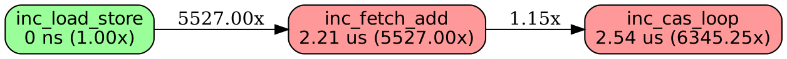

## atomic_inc_strategy_n16384

Measured at commit `266650fb`.

| variant | median | vs best |
|---|---|---|
| inc_load_store | 0 ns | 1.00x |
| inc_fetch_add | 33.70 us | 84241.00x |
| inc_cas_loop | 38.13 us | 95323.50x |

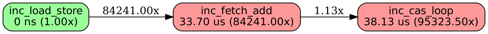

## atomic_inc_strategy_n256

Measured at commit `266650fb`.

| variant | median | vs best |
|---|---|---|
| inc_load_store | 0 ns | 0.00x |
| inc_fetch_add | 535 ns | 534600000000.00x |
| inc_cas_loop | 687 ns | 686900000000.00x |

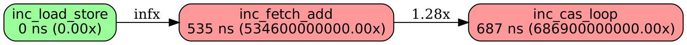

## atomic_inc_strategy_n4096

Measured at commit `266650fb`.

| variant | median | vs best |
|---|---|---|
| inc_load_store | 0 ns | 0.00x |
| inc_fetch_add | 8.48 us | 8479200000000.00x |
| inc_cas_loop | 9.77 us | 9771200000000.00x |

## atomic_vs_plain_n1024

Measured at commit `266650fb`.

| variant | median | vs best |
|---|---|---|
| acc_plain | 1.30 us | 1.00x |
| acc_atomic_seqcst | 1.31 us | 1.01x |
| acc_atomic_relaxed | 1.31 us | 1.01x |

## atomic_vs_plain_n16384

Measured at commit `266650fb`.

| variant | median | vs best |
|---|---|---|
| acc_atomic_relaxed | 20.46 us | 1.00x |
| acc_plain | 20.48 us | 1.00x |
| acc_atomic_seqcst | 20.50 us | 1.00x |

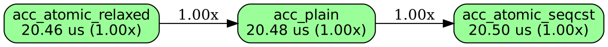

## atomic_vs_plain_n256

Measured at commit `266650fb`.

| variant | median | vs best |
|---|---|---|
| acc_atomic_seqcst | 272 ns | 1.00x |
| acc_plain | 305 ns | 1.12x |
| acc_atomic_relaxed | 308 ns | 1.13x |

## atomic_vs_plain_n4096

Measured at commit `266650fb`.

| variant | median | vs best |
|---|---|---|
| acc_atomic_relaxed | 5.28 us | 1.00x |
| acc_atomic_seqcst | 5.38 us | 1.02x |
| acc_plain | 5.42 us | 1.03x |

## bit_count_ops_n1024

Measured at commit `266650fb`.

| variant | median | vs best |
|---|---|---|
| ctz_debruijn | 64 ns | 1.00x |
| ctz_intrinsic | 65 ns | 1.03x |
| ctz_loop | 158 ns | 2.47x |

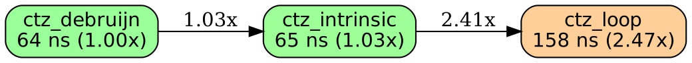

## bit_count_ops_n16384

Measured at commit `266650fb`.

| variant | median | vs best |
|---|---|---|
| ctz_intrinsic | 500 ns | 1.00x |
| ctz_debruijn | 512 ns | 1.02x |
| ctz_loop | 2.14 us | 4.29x |

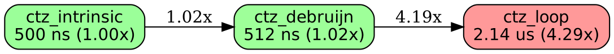

## bit_count_ops_n256

Measured at commit `266650fb`.

| variant | median | vs best |
|---|---|---|
| ctz_debruijn | 20 ns | 1.00x |
| ctz_intrinsic | 25 ns | 1.22x |
| ctz_loop | 55 ns | 2.69x |

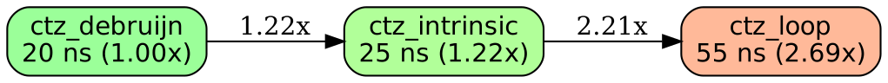

## bit_count_ops_n4096

Measured at commit `266650fb`.

| variant | median | vs best |
|---|---|---|
| ctz_intrinsic | 159 ns | 1.00x |
| ctz_debruijn | 169 ns | 1.06x |
| ctz_loop | 542 ns | 3.42x |

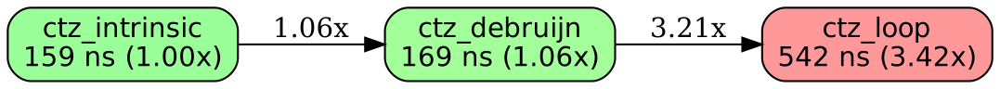

## bounds_check_n1024

Measured at commit `266650fb`.

| variant | median | vs best |
|---|---|---|
| bc_iter | 38 ns | 1.00x |
| bc_index | 40 ns | 1.04x |
| bc_unchecked | 41 ns | 1.07x |

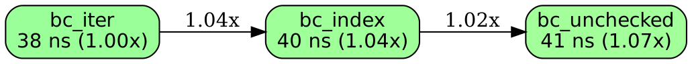

## bounds_check_n16384

Measured at commit `266650fb`.

| variant | median | vs best |
|---|---|---|
| bc_iter | 375 ns | 1.00x |
| bc_index | 379 ns | 1.01x |
| bc_unchecked | 673 ns | 1.79x |

## bounds_check_n256

Measured at commit `266650fb`.

| variant | median | vs best |
|---|---|---|
| bc_index | 5 ns | 1.00x |
| bc_iter | 5 ns | 1.08x |
| bc_unchecked | 6 ns | 1.16x |

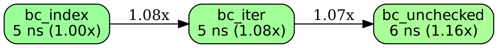

## bounds_check_n4096

Measured at commit `266650fb`.

| variant | median | vs best |
|---|---|---|
| bc_index | 103 ns | 1.00x |
| bc_iter | 104 ns | 1.01x |
| bc_unchecked | 150 ns | 1.45x |

## branch_pattern_n1024

Measured at commit `266650fb`.

| variant | median | vs best |
|---|---|---|
| branch_if | 1.72 us | 1.00x |
| branch_cmov | 1.72 us | 1.00x |

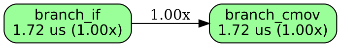

## branch_pattern_n16384

Measured at commit `266650fb`.

| variant | median | vs best |
|---|---|---|
| branch_if | 26.09 us | 1.00x |
| branch_cmov | 26.15 us | 1.00x |

## branch_pattern_n256

Measured at commit `266650fb`.

| variant | median | vs best |
|---|---|---|
| branch_if | 396 ns | 1.00x |
| branch_cmov | 445 ns | 1.12x |

## branch_pattern_n4096

Measured at commit `266650fb`.

| variant | median | vs best |
|---|---|---|
| branch_cmov | 6.72 us | 1.00x |
| branch_if | 6.72 us | 1.00x |

## branch_pattern_n64

Measured at commit `266650fb`.

| variant | median | vs best |
|---|---|---|
| branch_if | 90 ns | 1.00x |
| branch_cmov | 93 ns | 1.03x |

## branch_predictability_n1024

Measured at commit `266650fb`.

| variant | median | vs best |
|---|---|---|
| bp_balanced | 1.27 us | 1.00x |
| bp_skew_high | 1.34 us | 1.06x |
| bp_skew_low | 1.34 us | 1.06x |

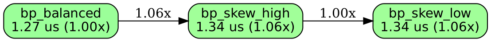

## branch_predictability_n16384

Measured at commit `266650fb`.

| variant | median | vs best |
|---|---|---|
| bp_balanced | 20.53 us | 1.00x |
| bp_skew_low | 20.54 us | 1.00x |
| bp_skew_high | 20.55 us | 1.00x |

## branch_predictability_n256

Measured at commit `266650fb`.

| variant | median | vs best |
|---|---|---|
| bp_skew_high | 332 ns | 1.00x |
| bp_skew_low | 332 ns | 1.00x |
| bp_balanced | 333 ns | 1.00x |

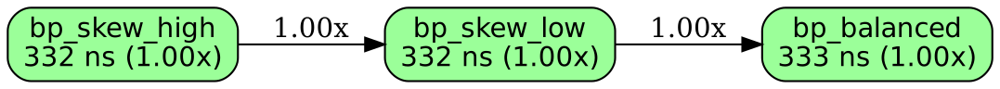

## branch_predictability_n4096

Measured at commit `266650fb`.

| variant | median | vs best |
|---|---|---|
| bp_skew_high | 5.30 us | 1.00x |
| bp_skew_low | 5.42 us | 1.02x |
| bp_balanced | 5.47 us | 1.03x |

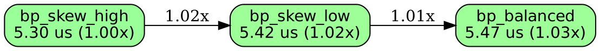

## cache_layout_n1024

Measured at commit `266650fb`.

| variant | median | vs best |
|---|---|---|
| layout_soa | 12 ns | 1.00x |
| layout_aos | 13 ns | 1.03x |

## cache_layout_n16384

Measured at commit `266650fb`.

| variant | median | vs best |
|---|---|---|
| layout_aos | 371 ns | 1.00x |
| layout_soa | 386 ns | 1.04x |

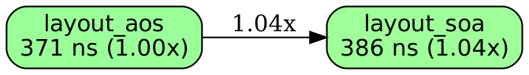

## cache_layout_n256

Measured at commit `266650fb`.

| variant | median | vs best |
|---|---|---|
| layout_soa | 1 ns | 1.00x |
| layout_aos | 1 ns | 1.50x |

## cache_layout_n4096

Measured at commit `266650fb`.

| variant | median | vs best |
|---|---|---|
| layout_aos | 65 ns | 1.00x |
| layout_soa | 69 ns | 1.06x |

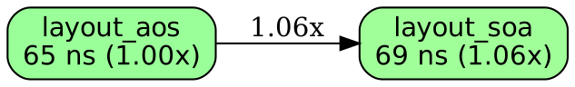

## cache_layout_n64

Measured at commit `266650fb`.

| variant | median | vs best |
|---|---|---|
| layout_aos | 0 ns | 1.00x |
| layout_soa | 0 ns | 1.00x |

## dep_graph_csr_9_n128

Measured at commit `266650fb`.

| variant | median | vs best |
|---|---|---|
| dep_graph_csr | 806 ns | 1.00x |
| dep_graph_hybrid | 808 ns | 1.00x |
| dep_graph_dense | 26.53 us | 32.92x |

## dep_graph_csr_9_n16

Measured at commit `266650fb`.

| variant | median | vs best |
|---|---|---|
| dep_graph_csr | 54 ns | 1.00x |
| dep_graph_hybrid | 452 ns | 8.39x |
| dep_graph_dense | 904 ns | 16.81x |

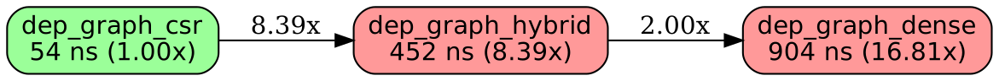

## dep_graph_csr_9_n256

Measured at commit `266650fb`.

| variant | median | vs best |
|---|---|---|
| dep_graph_hybrid | 1.58 us | 1.00x |
| dep_graph_csr | 1.66 us | 1.05x |
| dep_graph_dense | 104.06 us | 65.87x |

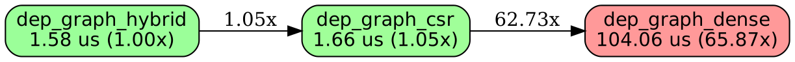

## dep_graph_csr_9_n32

Measured at commit `266650fb`.

| variant | median | vs best |
|---|---|---|
| dep_graph_csr | 158 ns | 1.00x |
| dep_graph_hybrid | 165 ns | 1.04x |
| dep_graph_dense | 2.26 us | 14.25x |

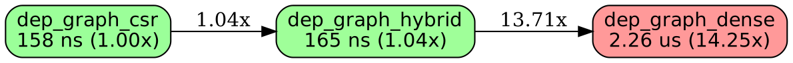

## dep_graph_csr_9_n64

Measured at commit `266650fb`.

| variant | median | vs best |
|---|---|---|
| dep_graph_hybrid | 372 ns | 1.00x |
| dep_graph_csr | 382 ns | 1.03x |
| dep_graph_dense | 7.49 us | 20.16x |

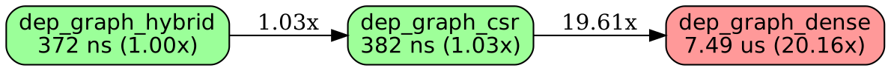

## dep_graph_csr_9_n8

Measured at commit `266650fb`.

| variant | median | vs best |
|---|---|---|
| dep_graph_csr | 27 ns | 1.00x |
| dep_graph_hybrid | 110 ns | 4.04x |
| dep_graph_dense | 581 ns | 21.42x |

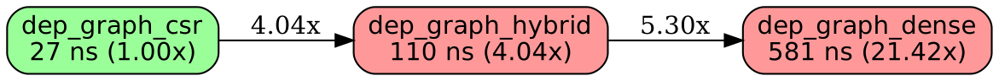

## dispatch_dynamic_n1024

Measured at commit `266650fb`.

| variant | median | vs best |
|---|---|---|
| dispatch_direct | 124 ns | 1.00x |
| dispatch_volatile | 166 ns | 1.34x |
| dispatch_runtime | 319 ns | 2.58x |

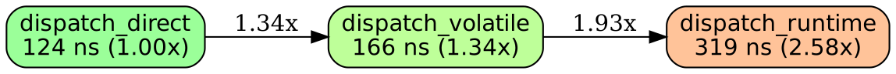

## dispatch_dynamic_n16384

Measured at commit `266650fb`.

| variant | median | vs best |
|---|---|---|
| dispatch_direct | 2.60 us | 1.00x |
| dispatch_volatile | 2.65 us | 1.02x |
| dispatch_runtime | 9.35 us | 3.60x |

## dispatch_dynamic_n256

Measured at commit `266650fb`.

| variant | median | vs best |
|---|---|---|
| dispatch_direct | 15 ns | 1.00x |
| dispatch_volatile | 47 ns | 3.23x |
| dispatch_runtime | 47 ns | 3.24x |

## dispatch_dynamic_n4096

Measured at commit `266650fb`.

| variant | median | vs best |
|---|---|---|
| dispatch_direct | 636 ns | 1.00x |
| dispatch_volatile | 677 ns | 1.06x |
| dispatch_runtime | 1.17 us | 1.83x |

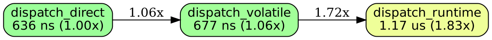

## dispatch_dynamic_n64

Measured at commit `266650fb`.

| variant | median | vs best |
|---|---|---|
| dispatch_direct | 2 ns | 1.00x |
| dispatch_volatile | 8 ns | 3.57x |
| dispatch_runtime | 10 ns | 4.57x |

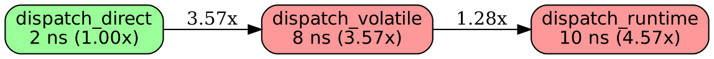

## dispatch_static_n1024

Measured at commit `266650fb`.

| variant | median | vs best |
|---|---|---|
| dispatch_const_ptr | 120 ns | 1.00x |
| dispatch_trait | 123 ns | 1.02x |
| dispatch_direct | 125 ns | 1.04x |

## dispatch_static_n16384

Measured at commit `266650fb`.

| variant | median | vs best |
|---|---|---|
| dispatch_const_ptr | 2.57 us | 1.00x |
| dispatch_trait | 2.61 us | 1.01x |
| dispatch_direct | 2.68 us | 1.04x |

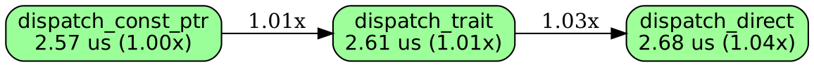

## dispatch_static_n256

Measured at commit `266650fb`.

| variant | median | vs best |
|---|---|---|
| dispatch_trait | 14 ns | 1.00x |
| dispatch_direct | 14 ns | 1.01x |
| dispatch_const_ptr | 15 ns | 1.08x |

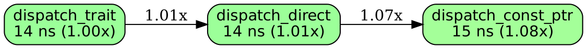

## dispatch_static_n4096

Measured at commit `266650fb`.

| variant | median | vs best |
|---|---|---|
| dispatch_const_ptr | 630 ns | 1.00x |
| dispatch_trait | 633 ns | 1.00x |
| dispatch_direct | 648 ns | 1.03x |

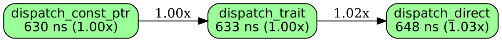

## dispatch_static_n64

Measured at commit `266650fb`.

| variant | median | vs best |
|---|---|---|
| dispatch_const_ptr | 2 ns | 1.00x |
| dispatch_direct | 2 ns | 1.00x |
| dispatch_trait | 2 ns | 1.00x |

## ema_axis_h_n1024

Measured at commit `266650fb`.

| variant | median | vs best |
|---|---|---|
| ema_neon | 45 ns | 1.00x |
| ema_scalar | 95 ns | 2.09x |
| ema_autovec | 392 ns | 8.65x |

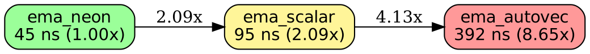

## ema_axis_h_n16384

Measured at commit `266650fb`.

| variant | median | vs best |
|---|---|---|
| ema_neon | 1.59 us | 1.00x |
| ema_scalar | 1.69 us | 1.06x |
| ema_autovec | 6.77 us | 4.26x |

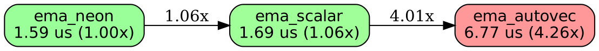

## ema_axis_h_n256

Measured at commit `266650fb`.

| variant | median | vs best |
|---|---|---|
| ema_neon | 1 ns | 1.00x |
| ema_scalar | 25 ns | 20.83x |
| ema_autovec | 88 ns | 72.92x |

## ema_axis_h_n4096

Measured at commit `266650fb`.

| variant | median | vs best |
|---|---|---|
| ema_neon | 310 ns | 1.00x |
| ema_scalar | 395 ns | 1.27x |
| ema_autovec | 1.70 us | 5.47x |

## ema_axis_h_n64

Measured at commit `266650fb`.

| variant | median | vs best |
|---|---|---|
| ema_autovec | 0 ns | 1.00x |
| ema_neon | 0 ns | 1.00x |
| ema_scalar | 3 ns | 7.25x |

## ema_formulation_n1024

Measured at commit `266650fb`.

| variant | median | vs best |
|---|---|---|
| ema_form_intshift | 1.29 us | 1.00x |
| ema_form_q32 | 1.93 us | 1.50x |
| ema_form_float | 2.24 us | 1.73x |

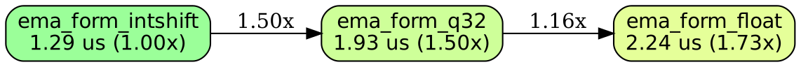

## ema_formulation_n16384

Measured at commit `266650fb`.

| variant | median | vs best |
|---|---|---|
| ema_form_intshift | 20.46 us | 1.00x |
| ema_form_q32 | 30.68 us | 1.50x |
| ema_form_float | 35.71 us | 1.74x |

## ema_formulation_n256

Measured at commit `266650fb`.

| variant | median | vs best |
|---|---|---|
| ema_form_intshift | 296 ns | 1.00x |
| ema_form_float | 439 ns | 1.48x |
| ema_form_q32 | 474 ns | 1.60x |

## ema_formulation_n4096

Measured at commit `266650fb`.

| variant | median | vs best |
|---|---|---|
| ema_form_intshift | 5.15 us | 1.00x |
| ema_form_q32 | 7.63 us | 1.48x |
| ema_form_float | 9.10 us | 1.77x |

## fiber_theory_n16

Measured at commit `266650fb`.

| variant | median | vs best |
|---|---|---|
| fib_greedy | 96 ns | 1.00x |
| fib_spectral | 64.19 us | 667.28x |

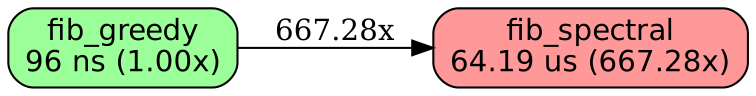

## fiber_theory_n32

Measured at commit `266650fb`.

| variant | median | vs best |
|---|---|---|
| fib_greedy | 191 ns | 1.00x |
| fib_spectral | 80.28 us | 419.41x |

## fiber_theory_n64

Measured at commit `266650fb`.

| variant | median | vs best |
|---|---|---|
| fib_greedy | 392 ns | 1.00x |
| fib_spectral | 128.20 us | 326.63x |

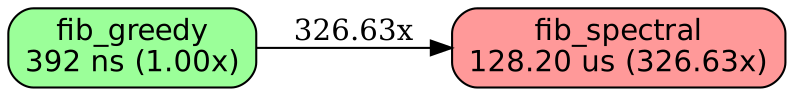

## fiber_theory_n8

Measured at commit `266650fb`.

| variant | median | vs best |
|---|---|---|
| fib_greedy | 36 ns | 1.00x |
| fib_spectral | 16.63 us | 459.44x |

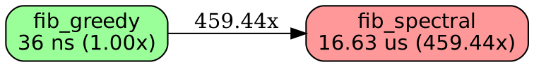

## float_width_n1024

Measured at commit `266650fb`.

| variant | median | vs best |
|---|---|---|
| float_f32 | 262 ns | 1.00x |
| float_f64 | 332 ns | 1.27x |
| float_i64_scaled | 479 ns | 1.83x |

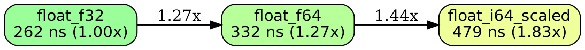

## float_width_n16384

Measured at commit `266650fb`.

| variant | median | vs best |
|---|---|---|
| float_f64 | 5.21 us | 1.00x |
| float_f32 | 5.22 us | 1.00x |
| float_i64_scaled | 6.45 us | 1.24x |

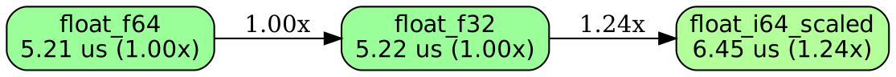

## float_width_n256

Measured at commit `266650fb`.

| variant | median | vs best |
|---|---|---|
| float_f32 | 50 ns | 1.00x |
| float_f64 | 75 ns | 1.50x |
| float_i64_scaled | 134 ns | 2.67x |

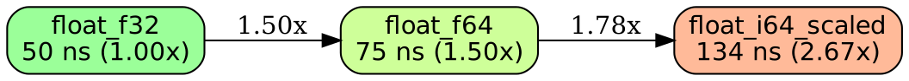

## float_width_n4096

Measured at commit `266650fb`.

| variant | median | vs best |
|---|---|---|
| float_f32 | 1.28 us | 1.00x |
| float_f64 | 1.36 us | 1.06x |
| float_i64_scaled | 1.74 us | 1.36x |

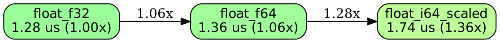

## fnptr_table_dispatch_n1024

Measured at commit `266650fb`.

| variant | median | vs best |
|---|---|---|
| fpt_match_16 | 236 ns | 1.00x |
| fpt_table_16 | 328 ns | 1.39x |

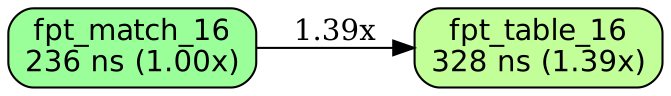

## fnptr_table_dispatch_n16384

Measured at commit `266650fb`.

| variant | median | vs best |
|---|---|---|
| fpt_match_16 | 10.26 us | 1.00x |
| fpt_table_16 | 11.37 us | 1.11x |

## fnptr_table_dispatch_n256

Measured at commit `266650fb`.

| variant | median | vs best |
|---|---|---|
| fpt_table_16 | 45 ns | 1.00x |
| fpt_match_16 | 71 ns | 1.58x |

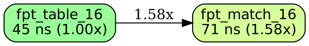

## fnptr_table_dispatch_n4096

Measured at commit `266650fb`.

| variant | median | vs best |
|---|---|---|
| fpt_match_16 | 841 ns | 1.00x |
| fpt_table_16 | 1.30 us | 1.55x |

## fold_strategy_n1024

Measured at commit `266650fb`.

| variant | median | vs best |
|---|---|---|
| fold_quad | 58 ns | 1.00x |
| fold_paired | 73 ns | 1.26x |
| fold_sequential | 113 ns | 1.93x |

## fold_strategy_n16384

Measured at commit `266650fb`.

| variant | median | vs best |
|---|---|---|
| fold_quad | 704 ns | 1.00x |
| fold_paired | 1.29 us | 1.83x |
| fold_sequential | 2.68 us | 3.81x |

## fold_strategy_n256

Measured at commit `266650fb`.

| variant | median | vs best |
|---|---|---|
| fold_paired | 13 ns | 1.00x |
| fold_quad | 15 ns | 1.16x |
| fold_sequential | 16 ns | 1.23x |

## fold_strategy_n4096

Measured at commit `266650fb`.

| variant | median | vs best |
|---|---|---|
| fold_quad | 197 ns | 1.00x |
| fold_paired | 331 ns | 1.68x |
| fold_sequential | 617 ns | 3.14x |

## fxpmul_strategy_n1024

Measured at commit `266650fb`.

| variant | median | vs best |
|---|---|---|
| fxpmul_hot | 102 ns | 1.00x |
| fxpmul_precise | 111 ns | 1.10x |

## fxpmul_strategy_n16384

Measured at commit `266650fb`.

| variant | median | vs best |
|---|---|---|
| fxpmul_hot | 1.70 us | 1.00x |
| fxpmul_precise | 1.98 us | 1.17x |

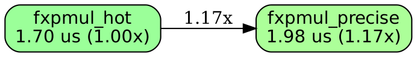

## fxpmul_strategy_n256

Measured at commit `266650fb`.

| variant | median | vs best |
|---|---|---|
| fxpmul_hot | 19 ns | 1.00x |
| fxpmul_precise | 27 ns | 1.43x |

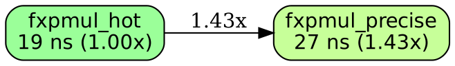

## fxpmul_strategy_n4096

Measured at commit `266650fb`.

| variant | median | vs best |
|---|---|---|
| fxpmul_hot | 401 ns | 1.00x |
| fxpmul_precise | 501 ns | 1.25x |

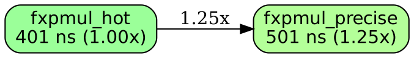

## fxpmul_strategy_n64

Measured at commit `266650fb`.

| variant | median | vs best |
|---|---|---|
| fxpmul_hot | 3 ns | 1.00x |
| fxpmul_precise | 3 ns | 1.00x |

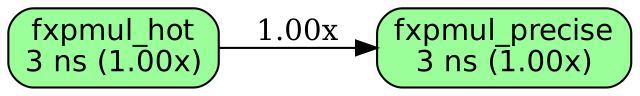

## hash_algos_n1024

Measured at commit `266650fb`.

| variant | median | vs best |
|---|---|---|
| hash_xxh | 235 ns | 1.00x |
| hash_sip | 287 ns | 1.22x |
| hash_fnv1a | 1.31 us | 5.58x |

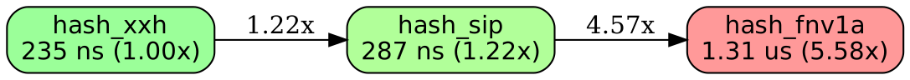

## hash_algos_n16384

Measured at commit `266650fb`.

| variant | median | vs best |
|---|---|---|
| hash_sip | 4.54 us | 1.00x |
| hash_xxh | 4.77 us | 1.05x |
| hash_fnv1a | 20.44 us | 4.50x |

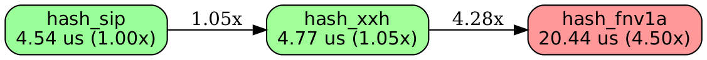

## hash_algos_n256

Measured at commit `266650fb`.

| variant | median | vs best |
|---|---|---|
| hash_xxh | 36 ns | 1.00x |
| hash_sip | 61 ns | 1.70x |
| hash_fnv1a | 288 ns | 8.05x |

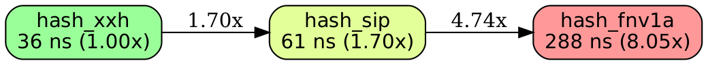

## hash_algos_n4096

Measured at commit `266650fb`.

| variant | median | vs best |
|---|---|---|
| hash_xxh | 1.15 us | 1.00x |
| hash_sip | 1.19 us | 1.04x |
| hash_fnv1a | 5.26 us | 4.59x |

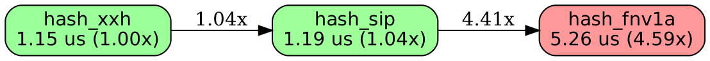

## hash_algos_n64

Measured at commit `266650fb`.

| variant | median | vs best |
|---|---|---|
| hash_xxh | 4 ns | 1.00x |
| hash_sip | 9 ns | 2.10x |
| hash_fnv1a | 39 ns | 9.24x |

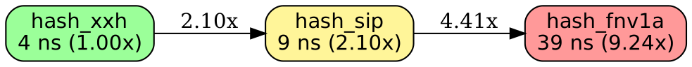

## inline_strategy_n1024

Measured at commit `266650fb`.

| variant | median | vs best |
|---|---|---|
| inline_always | 1.31 us | 1.00x |
| inline_default | 1.31 us | 1.00x |
| inline_never | 1.32 us | 1.00x |

## inline_strategy_n16384

Measured at commit `266650fb`.

| variant | median | vs best |
|---|---|---|
| inline_always | 20.46 us | 1.00x |
| inline_default | 20.49 us | 1.00x |
| inline_never | 20.52 us | 1.00x |

## inline_strategy_n256

Measured at commit `266650fb`.

| variant | median | vs best |
|---|---|---|
| inline_always | 276 ns | 1.00x |
| inline_default | 295 ns | 1.07x |
| inline_never | 336 ns | 1.22x |

## inline_strategy_n4096

Measured at commit `266650fb`.

| variant | median | vs best |
|---|---|---|
| inline_never | 5.32 us | 1.00x |
| inline_always | 5.42 us | 1.02x |
| inline_default | 5.43 us | 1.02x |

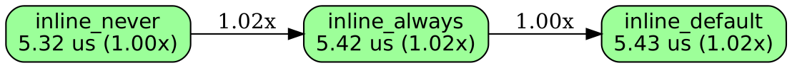

## iter_patterns_n1024

Measured at commit `266650fb`.

| variant | median | vs best |
|---|---|---|
| iter_strided | 4 ns | 1.00x |
| iter_seq | 118 ns | 31.76x |
| iter_gather | 265 ns | 71.73x |

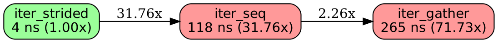

## iter_patterns_n16384

Measured at commit `266650fb`.

| variant | median | vs best |
|---|---|---|
| iter_strided | 279 ns | 1.00x |
| iter_seq | 2.63 us | 9.43x |
| iter_gather | 4.73 us | 16.96x |

## iter_patterns_n256

Measured at commit `266650fb`.

| variant | median | vs best |
|---|---|---|
| iter_strided | 1 ns | 1.00x |
| iter_seq | 17 ns | 21.38x |
| iter_gather | 47 ns | 58.38x |

## iter_patterns_n4096

Measured at commit `266650fb`.

| variant | median | vs best |
|---|---|---|
| iter_strided | 54 ns | 1.00x |
| iter_seq | 629 ns | 11.57x |
| iter_gather | 1.17 us | 21.51x |

## load_alignment_n1024

Measured at commit `266650fb`.

| variant | median | vs best |
|---|---|---|
| load_aligned | 113 ns | 1.00x |
| load_byte_pack | 115 ns | 1.02x |
| load_unaligned | 121 ns | 1.07x |

## load_alignment_n16384

Measured at commit `266650fb`.

| variant | median | vs best |
|---|---|---|
| load_aligned | 2.61 us | 1.00x |
| load_byte_pack | 2.65 us | 1.02x |
| load_unaligned | 2.69 us | 1.03x |

## load_alignment_n256

Measured at commit `266650fb`.

| variant | median | vs best |
|---|---|---|
| load_aligned | 15 ns | 1.00x |
| load_unaligned | 15 ns | 1.00x |
| load_byte_pack | 16 ns | 1.03x |

## load_alignment_n4096

Measured at commit `266650fb`.

| variant | median | vs best |
|---|---|---|
| load_aligned | 616 ns | 1.00x |
| load_unaligned | 630 ns | 1.02x |
| load_byte_pack | 631 ns | 1.02x |

## match_arm_count_n1024

Measured at commit `266650fb`.

| variant | median | vs best |
|---|---|---|
| match_2_arms | 107 ns | 1.00x |
| match_8_arms | 169 ns | 1.58x |
| match_64_arms | 249 ns | 2.33x |

## match_arm_count_n16384

Measured at commit `266650fb`.

| variant | median | vs best |
|---|---|---|
| match_2_arms | 1.40 us | 1.00x |
| match_8_arms | 2.65 us | 1.89x |
| match_64_arms | 12.03 us | 8.62x |

## match_arm_count_n256

Measured at commit `266650fb`.

| variant | median | vs best |
|---|---|---|
| match_2_arms | 28 ns | 1.00x |
| match_64_arms | 76 ns | 2.72x |
| match_8_arms | 100 ns | 3.58x |

## match_arm_count_n4096

Measured at commit `266650fb`.

| variant | median | vs best |
|---|---|---|
| match_2_arms | 371 ns | 1.00x |
| match_8_arms | 676 ns | 1.82x |
| match_64_arms | 941 ns | 2.54x |

## memcpy_patterns_n1024

Measured at commit `266650fb`.

| variant | median | vs best |
|---|---|---|
| memcpy_unrolled | 1.47 us | 1.00x |
| memcpy_intrinsic | 1.50 us | 1.02x |
| memcpy_naive | 1.52 us | 1.04x |

## memcpy_patterns_n16384

Measured at commit `266650fb`.

| variant | median | vs best |
|---|---|---|
| memcpy_intrinsic | 20.45 us | 1.00x |
| memcpy_unrolled | 20.47 us | 1.00x |
| memcpy_naive | 20.47 us | 1.00x |

## memcpy_patterns_n256

Measured at commit `266650fb`.

| variant | median | vs best |
|---|---|---|
| memcpy_intrinsic | 488 ns | 1.00x |
| memcpy_unrolled | 491 ns | 1.01x |
| memcpy_naive | 491 ns | 1.01x |

## memcpy_patterns_n4096

Measured at commit `266650fb`.

| variant | median | vs best |
|---|---|---|
| memcpy_unrolled | 5.50 us | 1.00x |
| memcpy_intrinsic | 5.62 us | 1.02x |
| memcpy_naive | 5.63 us | 1.02x |

## memcpy_patterns_n64

Measured at commit `266650fb`.

| variant | median | vs best |
|---|---|---|
| memcpy_unrolled | 39 ns | 1.00x |
| memcpy_naive | 40 ns | 1.01x |
| memcpy_intrinsic | 40 ns | 1.02x |

## minmax_strategy_n1024

Measured at commit `266650fb`.

| variant | median | vs best |
|---|---|---|
| minmax_branch | 42 ns | 1.00x |
| minmax_intrinsic | 42 ns | 1.00x |
| minmax_branchless | 42 ns | 1.01x |

## minmax_strategy_n16384

Measured at commit `266650fb`.

| variant | median | vs best |
|---|---|---|
| minmax_branch | 401 ns | 1.00x |
| minmax_intrinsic | 407 ns | 1.02x |
| minmax_branchless | 411 ns | 1.03x |

## minmax_strategy_n256

Measured at commit `266650fb`.

| variant | median | vs best |
|---|---|---|
| minmax_intrinsic | 22 ns | 1.00x |
| minmax_branchless | 24 ns | 1.05x |
| minmax_branch | 24 ns | 1.08x |

## minmax_strategy_n4096

Measured at commit `266650fb`.

| variant | median | vs best |
|---|---|---|
| minmax_branch | 117 ns | 1.00x |
| minmax_intrinsic | 117 ns | 1.00x |
| minmax_branchless | 123 ns | 1.05x |

## modulo_strategy_n1024

Measured at commit `266650fb`.

| variant | median | vs best |
|---|---|---|
| mod_pow2_const | 1.66 us | 1.00x |
| mod_npow2_const | 3.71 us | 2.24x |
| mod_var | 4.50 us | 2.71x |

## modulo_strategy_n16384

Measured at commit `266650fb`.

| variant | median | vs best |
|---|---|---|
| mod_pow2_const | 25.59 us | 1.00x |
| mod_npow2_const | 56.44 us | 2.21x |
| mod_var | 71.63 us | 2.80x |

## modulo_strategy_n256

Measured at commit `266650fb`.

| variant | median | vs best |
|---|---|---|
| mod_pow2_const | 370 ns | 1.00x |
| mod_npow2_const | 877 ns | 2.37x |
| mod_var | 1.08 us | 2.92x |

## modulo_strategy_n4096

Measured at commit `266650fb`.

| variant | median | vs best |
|---|---|---|
| mod_pow2_const | 6.57 us | 1.00x |
| mod_npow2_const | 14.32 us | 2.18x |
| mod_var | 18.17 us | 2.77x |

## popcount_strategy_n1024

Measured at commit `266650fb`.

| variant | median | vs best |
|---|---|---|
| popcount_std | 35 ns | 1.00x |
| popcount_swar | 155 ns | 4.38x |
| popcount_handrolled | 158 ns | 4.47x |

## popcount_strategy_n16384

Measured at commit `266650fb`.

| variant | median | vs best |
|---|---|---|
| popcount_std | 289 ns | 1.00x |
| popcount_swar | 2.03 us | 7.02x |
| popcount_handrolled | 2.08 us | 7.20x |

## popcount_strategy_n256

Measured at commit `266650fb`.

| variant | median | vs best |
|---|---|---|
| popcount_std | 4 ns | 1.00x |
| popcount_swar | 41 ns | 9.67x |
| popcount_handrolled | 42 ns | 10.02x |

## popcount_strategy_n4096

Measured at commit `266650fb`.

| variant | median | vs best |
|---|---|---|
| popcount_std | 92 ns | 1.00x |
| popcount_swar | 526 ns | 5.70x |
| popcount_handrolled | 530 ns | 5.74x |

## popcount_strategy_n64

Measured at commit `266650fb`.

| variant | median | vs best |
|---|---|---|
| popcount_std | 0 ns | 1.00x |
| popcount_handrolled | 5 ns | 12.50x |
| popcount_swar | 5 ns | 12.50x |

## rcm_order_n1024

Measured at commit `2c337b67`.

| variant | median | vs best |
|---|---|---|
| rcm_rev | 2.15 ms | 1.00x |
| rcm_adj | 2.24 ms | 1.04x |
| rcm_half | 2.27 ms | 1.06x |
| rcm_scr | 2.34 ms | 1.09x |

## rcm_order_n16384

Measured at commit `2c337b67`.

| variant | median | vs best |
|---|---|---|
| rcm_half | 37.11 ms | 1.00x |
| rcm_adj | 37.54 ms | 1.01x |
| rcm_scr | 37.79 ms | 1.02x |
| rcm_rev | 40.77 ms | 1.10x |

## rcm_order_n2048

Measured at commit `2c337b67`.

| variant | median | vs best |
|---|---|---|
| rcm_rev | 4.54 ms | 1.00x |
| rcm_adj | 4.54 ms | 1.00x |
| rcm_scr | 4.62 ms | 1.02x |
| rcm_half | 4.76 ms | 1.05x |

## rcm_order_n256

Measured at commit `2c337b67`.

| variant | median | vs best |
|---|---|---|
| rcm_rev | 374.54 us | 1.00x |
| rcm_adj | 394.46 us | 1.05x |
| rcm_scr | 400.38 us | 1.07x |
| rcm_half | 412.73 us | 1.10x |

## rcm_order_n4096

Measured at commit `2c337b67`.

| variant | median | vs best |
|---|---|---|
| rcm_half | 8.86 ms | 1.00x |
| rcm_rev | 8.99 ms | 1.01x |
| rcm_scr | 9.01 ms | 1.02x |
| rcm_adj | 9.23 ms | 1.04x |

## rcm_order_n64

Measured at commit `2c337b67`.

| variant | median | vs best |
|---|---|---|
| rcm_half | 95.41 us | 1.00x |
| rcm_rev | 97.32 us | 1.02x |
| rcm_scr | 99.14 us | 1.04x |
| rcm_adj | 102.92 us | 1.08x |

## rcm_order_n8192

Measured at commit `2c337b67`.

| variant | median | vs best |
|---|---|---|
| rcm_scr | 18.26 ms | 1.00x |
| rcm_adj | 18.29 ms | 1.00x |
| rcm_half | 18.57 ms | 1.02x |
| rcm_rev | 18.99 ms | 1.04x |

## rcm_rivals_n1024

Measured at commit `2c337b67`.

| variant | median | vs best |
|---|---|---|
| riv_rowm | 3.76 ms | 1.00x |
| riv_spec | 3.77 ms | 1.00x |
| riv_snake | 3.80 ms | 1.01x |
| riv_rcm | 3.86 ms | 1.03x |
| riv_scr | 3.95 ms | 1.05x |

## rcm_rivals_n16384

Measured at commit `2c337b67`.

| variant | median | vs best |
|---|---|---|
| riv_rcm | 106.11 ms | 1.00x |
| riv_snake | 108.51 ms | 1.02x |
| riv_scr | 110.35 ms | 1.04x |
| riv_spec | 124.67 ms | 1.17x |
| riv_rowm | 176.58 ms | 1.66x |

## rcm_rivals_n2048

Measured at commit `2c337b67`.

| variant | median | vs best |
|---|---|---|
| riv_scr | 8.27 ms | 1.00x |
| riv_snake | 8.31 ms | 1.00x |
| riv_spec | 8.34 ms | 1.01x |
| riv_rcm | 8.34 ms | 1.01x |
| riv_rowm | 8.49 ms | 1.03x |

## rcm_rivals_n256

Measured at commit `2c337b67`.

| variant | median | vs best |
|---|---|---|
| riv_snake | 872.60 us | 1.00x |
| riv_spec | 875.08 us | 1.00x |
| riv_rcm | 876.86 us | 1.00x |
| riv_rowm | 907.75 us | 1.04x |
| riv_scr | 920.12 us | 1.05x |

## rcm_rivals_n4096

Measured at commit `2c337b67`.

| variant | median | vs best |
|---|---|---|
| riv_rcm | 16.03 ms | 1.00x |
| riv_rowm | 16.10 ms | 1.00x |
| riv_snake | 16.10 ms | 1.00x |
| riv_spec | 16.16 ms | 1.01x |
| riv_scr | 16.26 ms | 1.01x |

## rcm_rivals_n64

Measured at commit `2c337b67`.

| variant | median | vs best |
|---|---|---|
| riv_spec | 188.20 us | 1.00x |
| riv_snake | 189.53 us | 1.01x |
| riv_rcm | 190.89 us | 1.01x |
| riv_scr | 191.46 us | 1.02x |
| riv_rowm | 195.05 us | 1.04x |

## rcm_rivals_n8192

Measured at commit `2c337b67`.

| variant | median | vs best |
|---|---|---|
| riv_rowm | 31.72 ms | 1.00x |
| riv_scr | 31.80 ms | 1.00x |
| riv_snake | 31.87 ms | 1.00x |
| riv_rcm | 31.88 ms | 1.01x |
| riv_spec | 31.92 ms | 1.01x |

## registration_binding_n16384

Measured at commit `266650fb`.

| variant | median | vs best |
|---|---|---|
| reg_typed | 845 ns | 1.00x |
| reg_typed_twin | 845 ns | 1.00x |
| reg_bound_columns | 848 ns | 1.00x |
| reg_bound_units | 863 ns | 1.02x |
| reg_bound_strided | 4.97 us | 5.88x |
| reg_bound_record | 21.88 us | 25.89x |

## registration_binding_n262144

Measured at commit `266650fb`.

| variant | median | vs best |
|---|---|---|
| reg_typed_twin | 16.55 us | 1.00x |
| reg_typed | 16.56 us | 1.00x |
| reg_bound_columns | 17.26 us | 1.04x |
| reg_bound_units | 17.69 us | 1.07x |
| reg_bound_strided | 79.58 us | 4.81x |
| reg_bound_record | 352.85 us | 21.32x |

## registration_binding_n4096

Measured at commit `266650fb`.

| variant | median | vs best |
|---|---|---|
| reg_bound_units | 217 ns | 1.00x |
| reg_bound_columns | 222 ns | 1.02x |
| reg_typed_twin | 233 ns | 1.07x |
| reg_typed | 236 ns | 1.09x |
| reg_bound_strided | 1.27 us | 5.86x |
| reg_bound_record | 5.51 us | 25.38x |

## registration_binding_n65536

Measured at commit `266650fb`.

| variant | median | vs best |
|---|---|---|
| reg_typed_twin | 4.36 us | 1.00x |
| reg_typed | 4.37 us | 1.00x |
| reg_bound_columns | 4.51 us | 1.03x |
| reg_bound_units | 4.62 us | 1.06x |
| reg_bound_strided | 19.86 us | 4.55x |
| reg_bound_record | 88.51 us | 20.30x |

## rotate_strategy_n1024

Measured at commit `266650fb`.

| variant | median | vs best |
|---|---|---|
| rot_intrinsic_const | 74 ns | 1.00x |
| rot_manual_shifts | 74 ns | 1.01x |
| rot_variable_amount | 247 ns | 3.34x |

## rotate_strategy_n16384

Measured at commit `266650fb`.

| variant | median | vs best |
|---|---|---|
| rot_manual_shifts | 1.28 us | 1.00x |
| rot_intrinsic_const | 1.28 us | 1.00x |
| rot_variable_amount | 3.96 us | 3.09x |

## rotate_strategy_n256

Measured at commit `266650fb`.

| variant | median | vs best |
|---|---|---|
| rot_manual_shifts | 5 ns | 1.00x |
| rot_intrinsic_const | 6 ns | 1.07x |
| rot_variable_amount | 50 ns | 9.30x |

## rotate_strategy_n4096

Measured at commit `266650fb`.

| variant | median | vs best |
|---|---|---|
| rot_manual_shifts | 309 ns | 1.00x |
| rot_intrinsic_const | 314 ns | 1.02x |
| rot_variable_amount | 1.01 us | 3.28x |

## sat_arithmetic_n1024

Measured at commit `266650fb`.

| variant | median | vs best |
|---|---|---|
| sat_wrap | 363 ns | 1.00x |
| sat_checked | 698 ns | 1.92x |
| sat_saturate | 699 ns | 1.92x |

## sat_arithmetic_n16384

Measured at commit `266650fb`.

| variant | median | vs best |
|---|---|---|
| sat_wrap | 5.14 us | 1.00x |
| sat_checked | 10.39 us | 2.02x |
| sat_saturate | 10.45 us | 2.03x |

## sat_arithmetic_n256

Measured at commit `266650fb`.

| variant | median | vs best |
|---|---|---|
| sat_wrap | 107 ns | 1.00x |
| sat_saturate | 180 ns | 1.68x |
| sat_checked | 184 ns | 1.72x |

## sat_arithmetic_n4096

Measured at commit `266650fb`.

| variant | median | vs best |
|---|---|---|
| sat_wrap | 1.34 us | 1.00x |
| sat_saturate | 2.66 us | 1.98x |
| sat_checked | 2.75 us | 2.05x |

## shift_amount_origin_n1024

Measured at commit `266650fb`.

| variant | median | vs best |
|---|---|---|
| shr_const | 5 ns | 1.00x |
| shr_loop_invariant | 6 ns | 1.07x |
| shr_per_iter | 66 ns | 12.26x |

## shift_amount_origin_n16384

Measured at commit `266650fb`.

| variant | median | vs best |
|---|---|---|
| shr_const | 195 ns | 1.00x |
| shr_loop_invariant | 205 ns | 1.05x |
| shr_per_iter | 710 ns | 3.64x |

## shift_amount_origin_n256

Measured at commit `266650fb`.

| variant | median | vs best |
|---|---|---|
| shr_const | 1 ns | 1.00x |
| shr_loop_invariant | 2 ns | 3.12x |
| shr_per_iter | 7 ns | 8.87x |

## shift_amount_origin_n4096

Measured at commit `266650fb`.

| variant | median | vs best |
|---|---|---|
| shr_const | 70 ns | 1.00x |
| shr_loop_invariant | 70 ns | 1.01x |
| shr_per_iter | 193 ns | 2.78x |

## swap_band_n1024

Measured at commit `266650fb`.

| variant | median | vs best |
|---|---|---|
| sb_none | 10.04 us | 1.00x |
| sb_plan | 12.35 us | 1.23x |
| sb_value | 155.06 us | 15.45x |

## swap_band_n64

Measured at commit `266650fb`.

| variant | median | vs best |
|---|---|---|
| sb_none | 10.02 us | 1.00x |
| sb_plan | 12.53 us | 1.25x |
| sb_value | 17.82 us | 1.78x |

## swap_band_n8192

Measured at commit `266650fb`.

| variant | median | vs best |
|---|---|---|
| sb_none | 12.92 us | 1.00x |
| sb_plan | 15.24 us | 1.18x |
| sb_value | 2.54 ms | 196.70x |

## swap_column_n1024

Measured at commit `266650fb`.

| variant | median | vs best |
|---|---|---|
| cs_plain | 209.26 us | 1.00x |
| cs_exch | 210.39 us | 1.01x |
| cs_snap | 301.32 us | 1.44x |
| cs_snap_twin | 307.54 us | 1.47x |

## swap_column_n64

Measured at commit `266650fb`.

| variant | median | vs best |
|---|---|---|
| cs_exch | 21.75 us | 1.00x |
| cs_plain | 21.80 us | 1.00x |
| cs_snap | 27.07 us | 1.24x |
| cs_snap_twin | 27.46 us | 1.26x |

## swap_column_n8192

Measured at commit `266650fb`.

| variant | median | vs best |
|---|---|---|
| cs_exch | 2.25 ms | 1.00x |
| cs_plain | 3.18 ms | 1.41x |
| cs_snap_twin | 3.26 ms | 1.45x |
| cs_snap | 3.29 ms | 1.46x |

## swap_cost_n64

Measured at commit `266650fb`.

| variant | median | vs best |
|---|---|---|
| sc_v64b | 2 ns | 1.00x |
| sc_v1k | 71 ns | 33.81x |
| sc_v64k | 1.71 us | 815.19x |

## wake_policy_n1024

Measured at commit `266650fb`.

| variant | median | vs best |
|---|---|---|
| wp_park | 8.74 us | 1.00x |
| wp_nh128 | 8.99 us | 1.03x |
| wp_lp0 | 9.03 us | 1.03x |
| wp_isb8 | 9.45 us | 1.08x |
| wp_nh2k | 12.17 us | 1.39x |
| wp_spin | 13.57 us | 1.55x |
| wp_nh8k | 17.71 us | 2.03x |

## wake_policy_n64

Measured at commit `266650fb`.

| variant | median | vs best |
|---|---|---|
| wp_lp0 | 5.07 us | 1.00x |
| wp_park | 5.14 us | 1.01x |
| wp_isb8 | 5.55 us | 1.09x |
| wp_nh128 | 6.17 us | 1.22x |
| wp_nh2k | 9.66 us | 1.91x |
| wp_spin | 10.64 us | 2.10x |
| wp_nh8k | 10.89 us | 2.15x |

## wake_policy_n8192

Measured at commit `266650fb`.

| variant | median | vs best |
|---|---|---|
| wp_lp0 | 28.48 us | 1.00x |
| wp_isb8 | 30.41 us | 1.07x |
| wp_park | 33.34 us | 1.17x |
| wp_nh2k | 33.90 us | 1.19x |
| wp_nh128 | 34.09 us | 1.20x |
| wp_spin | 34.88 us | 1.22x |
| wp_nh8k | 41.65 us | 1.46x |

