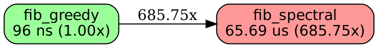
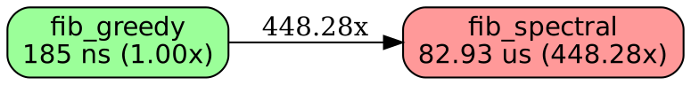
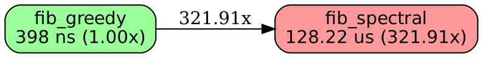
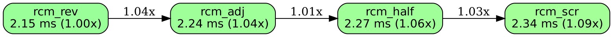
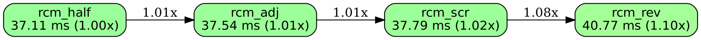
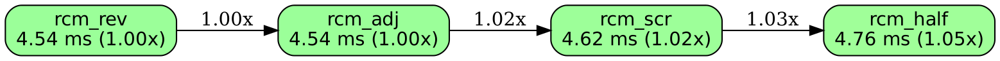
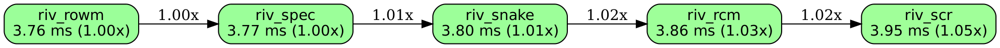
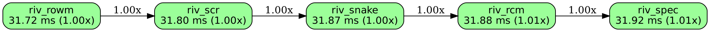
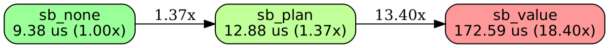
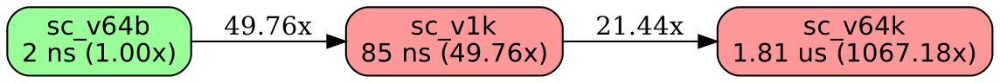

<!--
  AUTO-GENERATED: DO NOT EDIT DIRECTLY

  Generated by: mockspace (mock)
  Generated at: 2026-11-13T11:55:40Z
  Source: mock/
  To regenerate: cargo mock
-->
# Benchmarks

Latest measured medians per benchmark, from the bench framework's history log. Succinct by design: for the full data behind any number (per-sample CSVs, environment metadata, statistical findings), see `mock/benches/results/` in the repository.

## fiber_theory_n16

Measured at commit `e4cd1757`.

| variant | median | vs best |
|---|---|---|
| fib_greedy | 96 ns | 1.00x |
| fib_spectral | 65.69 us | 685.75x |

## fiber_theory_n32

Measured at commit `e4cd1757`.

| variant | median | vs best |
|---|---|---|
| fib_greedy | 185 ns | 1.00x |
| fib_spectral | 82.93 us | 448.28x |

## fiber_theory_n64

Measured at commit `e4cd1757`.

| variant | median | vs best |
|---|---|---|
| fib_greedy | 398 ns | 1.00x |
| fib_spectral | 128.22 us | 321.91x |

## fiber_theory_n8

Measured at commit `e4cd1757`.

| variant | median | vs best |
|---|---|---|
| fib_greedy | 38 ns | 1.00x |
| fib_spectral | 17.20 us | 448.97x |

## rcm_order_n1024

Measured at commit `2c337b67`.

| variant | median | vs best |
|---|---|---|
| rcm_rev | 2.15 ms | 1.00x |
| rcm_adj | 2.24 ms | 1.04x |
| rcm_half | 2.27 ms | 1.06x |
| rcm_scr | 2.34 ms | 1.09x |

## rcm_order_n16384

Measured at commit `2c337b67`.

| variant | median | vs best |
|---|---|---|
| rcm_half | 37.11 ms | 1.00x |
| rcm_adj | 37.54 ms | 1.01x |
| rcm_scr | 37.79 ms | 1.02x |
| rcm_rev | 40.77 ms | 1.10x |

## rcm_order_n2048

Measured at commit `2c337b67`.

| variant | median | vs best |
|---|---|---|
| rcm_rev | 4.54 ms | 1.00x |
| rcm_adj | 4.54 ms | 1.00x |
| rcm_scr | 4.62 ms | 1.02x |
| rcm_half | 4.76 ms | 1.05x |

## rcm_order_n256

Measured at commit `2c337b67`.

| variant | median | vs best |
|---|---|---|
| rcm_rev | 374.54 us | 1.00x |
| rcm_adj | 394.46 us | 1.05x |
| rcm_scr | 400.38 us | 1.07x |
| rcm_half | 412.73 us | 1.10x |

## rcm_order_n4096

Measured at commit `2c337b67`.

| variant | median | vs best |
|---|---|---|
| rcm_half | 8.86 ms | 1.00x |
| rcm_rev | 8.99 ms | 1.01x |
| rcm_scr | 9.01 ms | 1.02x |
| rcm_adj | 9.23 ms | 1.04x |

## rcm_order_n64

Measured at commit `2c337b67`.

| variant | median | vs best |
|---|---|---|
| rcm_half | 95.41 us | 1.00x |
| rcm_rev | 97.32 us | 1.02x |
| rcm_scr | 99.14 us | 1.04x |
| rcm_adj | 102.92 us | 1.08x |

## rcm_order_n8192

Measured at commit `2c337b67`.

| variant | median | vs best |
|---|---|---|
| rcm_scr | 18.26 ms | 1.00x |
| rcm_adj | 18.29 ms | 1.00x |
| rcm_half | 18.57 ms | 1.02x |
| rcm_rev | 18.99 ms | 1.04x |

## rcm_rivals_n1024

Measured at commit `2c337b67`.

| variant | median | vs best |
|---|---|---|
| riv_rowm | 3.76 ms | 1.00x |
| riv_spec | 3.77 ms | 1.00x |
| riv_snake | 3.80 ms | 1.01x |
| riv_rcm | 3.86 ms | 1.03x |
| riv_scr | 3.95 ms | 1.05x |

## rcm_rivals_n16384

Measured at commit `2c337b67`.

| variant | median | vs best |
|---|---|---|
| riv_rcm | 106.11 ms | 1.00x |
| riv_snake | 108.51 ms | 1.02x |
| riv_scr | 110.35 ms | 1.04x |
| riv_spec | 124.67 ms | 1.17x |
| riv_rowm | 176.58 ms | 1.66x |

## rcm_rivals_n2048

Measured at commit `2c337b67`.

| variant | median | vs best |
|---|---|---|
| riv_scr | 8.27 ms | 1.00x |
| riv_snake | 8.31 ms | 1.00x |
| riv_spec | 8.34 ms | 1.01x |
| riv_rcm | 8.34 ms | 1.01x |
| riv_rowm | 8.49 ms | 1.03x |

## rcm_rivals_n256

Measured at commit `2c337b67`.

| variant | median | vs best |
|---|---|---|
| riv_snake | 872.60 us | 1.00x |
| riv_spec | 875.08 us | 1.00x |
| riv_rcm | 876.86 us | 1.00x |
| riv_rowm | 907.75 us | 1.04x |
| riv_scr | 920.12 us | 1.05x |

## rcm_rivals_n4096

Measured at commit `2c337b67`.

| variant | median | vs best |
|---|---|---|
| riv_rcm | 16.03 ms | 1.00x |
| riv_rowm | 16.10 ms | 1.00x |
| riv_snake | 16.10 ms | 1.00x |
| riv_spec | 16.16 ms | 1.01x |
| riv_scr | 16.26 ms | 1.01x |

## rcm_rivals_n64

Measured at commit `2c337b67`.

| variant | median | vs best |
|---|---|---|
| riv_spec | 188.20 us | 1.00x |
| riv_snake | 189.53 us | 1.01x |
| riv_rcm | 190.89 us | 1.01x |
| riv_scr | 191.46 us | 1.02x |
| riv_rowm | 195.05 us | 1.04x |

## rcm_rivals_n8192

Measured at commit `2c337b67`.

| variant | median | vs best |
|---|---|---|
| riv_rowm | 31.72 ms | 1.00x |
| riv_scr | 31.80 ms | 1.00x |
| riv_snake | 31.87 ms | 1.00x |
| riv_rcm | 31.88 ms | 1.01x |
| riv_spec | 31.92 ms | 1.01x |

## swap_band_n1024

Measured at commit `8c3a949d`.

| variant | median | vs best |
|---|---|---|
| sb_none | 9.38 us | 1.00x |
| sb_plan | 12.88 us | 1.37x |
| sb_value | 172.59 us | 18.40x |

## swap_band_n64

Measured at commit `8c3a949d`.

| variant | median | vs best |
|---|---|---|
| sb_none | 9.95 us | 1.00x |
| sb_plan | 14.03 us | 1.41x |
| sb_value | 22.23 us | 2.23x |

## swap_band_n8192

Measured at commit `8c3a949d`.

| variant | median | vs best |
|---|---|---|
| sb_none | 10.90 us | 1.00x |
| sb_plan | 14.34 us | 1.32x |
| sb_value | 2.61 ms | 239.35x |

## swap_cost_n64

Measured at commit `8c3a949d`.

| variant | median | vs best |
|---|---|---|
| sc_v64b | 2 ns | 1.00x |
| sc_v1k | 85 ns | 49.76x |
| sc_v64k | 1.81 us | 1067.18x |

## wake_policy_n1024

Measured at commit `a12070de`.

| variant | median | vs best |
|---|---|---|
| wp_park | 10.08 us | 1.00x |
| wp_lp0 | 10.23 us | 1.01x |
| wp_nh128 | 10.69 us | 1.06x |
| wp_isb8 | 11.65 us | 1.16x |
| wp_nh2k | 12.53 us | 1.24x |
| wp_spin | 14.01 us | 1.39x |
| wp_nh8k | 18.13 us | 1.80x |

## wake_policy_n64

Measured at commit `a12070de`.

| variant | median | vs best |
|---|---|---|
| wp_park | 6.62 us | 1.00x |
| wp_lp0 | 6.69 us | 1.01x |
| wp_nh128 | 7.68 us | 1.16x |
| wp_isb8 | 8.07 us | 1.22x |
| wp_spin | 11.33 us | 1.71x |
| wp_nh2k | 12.75 us | 1.93x |
| wp_nh8k | 12.96 us | 1.96x |

## wake_policy_n8192

Measured at commit `a12070de`.

| variant | median | vs best |
|---|---|---|
| wp_park | 25.37 us | 1.00x |
| wp_nh2k | 26.97 us | 1.06x |
| wp_nh128 | 28.05 us | 1.11x |
| wp_isb8 | 28.17 us | 1.11x |
| wp_lp0 | 31.92 us | 1.26x |
| wp_spin | 34.22 us | 1.35x |
| wp_nh8k | 35.52 us | 1.40x |

