<!--
  AUTO-GENERATED: DO NOT EDIT DIRECTLY

  Generated by: mockspace (mock)
  Generated at: 2026-11-22T21:16:14Z
  Source: mock/
  To regenerate: cargo mock
-->
# Benchmarks

Latest measured medians per cell and machine class, from the latest run of each. Succinct by design: for the full data behind any number (per-sample CSVs, environment metadata, statistical findings), see `mock/benches/results/` in the repository.

## accumulator_grouped/w1_g64_n1048576 on linux-x86_64-c4-container-intel

Run `20261119T215331Z-a2c60c57-dirty`.

| variant | median | vs best |
|---|---|---|
| per_core | 4.57 ms | 1.00x |
| sequential | 4.76 ms | 1.04x |
| grouped | 4.89 ms | 1.07x |

## accumulator_grouped/w1_g64_n4096 on linux-x86_64-c4-container-intel

Run `20261119T215331Z-a2c60c57-dirty`.

| variant | median | vs best |
|---|---|---|
| grouped | 29.46 us | 1.00x |
| sequential | 29.64 us | 1.01x |
| per_core | 31.32 us | 1.06x |

## accumulator_grouped/w1_g64_n65536 on linux-x86_64-c4-container-intel

Run `20261119T215331Z-a2c60c57-dirty`.

| variant | median | vs best |
|---|---|---|
| per_core | 313.11 us | 1.00x |
| sequential | 323.28 us | 1.03x |
| grouped | 337.76 us | 1.08x |

## accumulator_grouped/w2_g64_n1048576 on linux-x86_64-c4-container-intel

Run `20261119T215331Z-a2c60c57-dirty`.

| variant | median | vs best |
|---|---|---|
| per_core | 2.49 ms | 1.00x |
| grouped | 2.55 ms | 1.03x |
| sequential | 4.54 ms | 1.83x |

## accumulator_grouped/w2_g64_n4096 on linux-x86_64-c4-container-intel

Run `20261119T215331Z-a2c60c57-dirty`.

| variant | median | vs best |
|---|---|---|
| sequential | 25.54 us | 1.00x |
| per_core | 31.34 us | 1.23x |
| grouped | 32.25 us | 1.26x |

## accumulator_grouped/w2_g64_n65536 on linux-x86_64-c4-container-intel

Run `20261119T215331Z-a2c60c57-dirty`.

| variant | median | vs best |
|---|---|---|
| per_core | 134.79 us | 1.00x |
| grouped | 164.57 us | 1.22x |
| sequential | 321.31 us | 2.38x |

## accumulator_grouped/w3_g64_n1048576 on linux-x86_64-c4-container-intel

Run `20261119T215331Z-a2c60c57-dirty`.

| variant | median | vs best |
|---|---|---|
| per_core | 1.78 ms | 1.00x |
| grouped | 1.81 ms | 1.02x |
| sequential | 4.59 ms | 2.58x |

## accumulator_grouped/w3_g64_n4096 on linux-x86_64-c4-container-intel

Run `20261119T215331Z-a2c60c57-dirty`.

| variant | median | vs best |
|---|---|---|
| sequential | 27.93 us | 1.00x |
| grouped | 40.75 us | 1.46x |
| per_core | 47.54 us | 1.70x |

## accumulator_grouped/w3_g64_n65536 on linux-x86_64-c4-container-intel

Run `20261119T215331Z-a2c60c57-dirty`.

| variant | median | vs best |
|---|---|---|
| per_core | 111.92 us | 1.00x |
| grouped | 125.62 us | 1.12x |
| sequential | 315.19 us | 2.82x |

## accumulator_grouped/w4_g1024_n1048576 on linux-x86_64-c4-container-intel

Run `20261119T215331Z-a2c60c57-dirty`.

| variant | median | vs best |
|---|---|---|
| per_core | 2.28 ms | 1.00x |
| grouped | 2.28 ms | 1.00x |
| sequential | 4.69 ms | 2.06x |

## accumulator_grouped/w4_g1024_n4096 on linux-x86_64-c4-container-intel

Run `20261119T215331Z-a2c60c57-dirty`.

| variant | median | vs best |
|---|---|---|
| sequential | 27.31 us | 1.00x |
| grouped | 40.96 us | 1.50x |
| per_core | 48.33 us | 1.77x |

## accumulator_grouped/w4_g1024_n65536 on linux-x86_64-c4-container-intel

Run `20261119T215331Z-a2c60c57-dirty`.

| variant | median | vs best |
|---|---|---|
| grouped | 131.57 us | 1.00x |
| per_core | 143.63 us | 1.09x |
| sequential | 289.81 us | 2.20x |

## accumulator_grouped/w4_g64_n1048576 on linux-x86_64-c4-container-intel

Run `20261119T215331Z-a2c60c57-dirty`.

| variant | median | vs best |
|---|---|---|
| per_core | 2.34 ms | 1.00x |
| grouped | 2.56 ms | 1.09x |
| sequential | 4.97 ms | 2.13x |

## accumulator_grouped/w4_g64_n4096 on linux-x86_64-c4-container-intel

Run `20261119T215331Z-a2c60c57-dirty`.

| variant | median | vs best |
|---|---|---|
| sequential | 29.60 us | 1.00x |
| per_core | 41.21 us | 1.39x |
| grouped | 46.35 us | 1.57x |

## accumulator_grouped/w4_g64_n65536 on linux-x86_64-c4-container-intel

Run `20261119T215331Z-a2c60c57-dirty`.

| variant | median | vs best |
|---|---|---|
| per_core | 138.29 us | 1.00x |
| grouped | 166.92 us | 1.21x |
| sequential | 296.03 us | 2.14x |

## accumulator_grouped/w4_g8_n1048576 on linux-x86_64-c4-container-intel

Run `20261119T215331Z-a2c60c57-dirty`.

| variant | median | vs best |
|---|---|---|
| per_core | 2.45 ms | 1.00x |
| grouped | 3.17 ms | 1.30x |
| sequential | 4.76 ms | 1.95x |

## accumulator_grouped/w4_g8_n4096 on linux-x86_64-c4-container-intel

Run `20261119T215331Z-a2c60c57-dirty`.

| variant | median | vs best |
|---|---|---|
| sequential | 26.10 us | 1.00x |
| per_core | 44.67 us | 1.71x |
| grouped | 53.77 us | 2.06x |

## accumulator_grouped/w4_g8_n65536 on linux-x86_64-c4-container-intel

Run `20261119T215331Z-a2c60c57-dirty`.

| variant | median | vs best |
|---|---|---|
| per_core | 171.78 us | 1.00x |
| grouped | 209.94 us | 1.22x |
| sequential | 346.37 us | 2.02x |

## atomic_inc_strategy/atomic_inc_strategy_n1024 on linux-x86_64-c16-bare-intel

Run `20261115T020533Z-266650fb-dirty`.

| variant | median | vs best |
|---|---|---|
| inc_load_store | 10 ns | 1.00x |
| inc_fetch_add | 4.69 us | 450.56x |
| inc_cas_loop | 8.34 us | 801.46x |

## atomic_inc_strategy/atomic_inc_strategy_n1024 on macos-aarch64-c8-bare-apple

Run `20261116T074608Z-dea557ae`.

| variant | median | vs best |
|---|---|---|
| inc_load_store | 0 ns | 1.00x |
| inc_fetch_add | 2.10 us | 10500.00x |
| inc_cas_loop | 2.42 us | 12104.00x |

## atomic_inc_strategy/atomic_inc_strategy_n16384 on linux-x86_64-c16-bare-intel

Run `20261115T021047Z-266650fb-dirty`.

| variant | median | vs best |
|---|---|---|
| inc_load_store | 10 ns | 1.00x |
| inc_fetch_add | 82.17 us | 7825.81x |
| inc_cas_loop | 146.50 us | 13952.07x |

## atomic_inc_strategy/atomic_inc_strategy_n16384 on macos-aarch64-c8-bare-apple

Run `20261116T074608Z-dea557ae`.

| variant | median | vs best |
|---|---|---|
| inc_load_store | 0 ns | 1.00x |
| inc_fetch_add | 34.36 us | 85893.75x |
| inc_cas_loop | 38.84 us | 97092.25x |

## atomic_inc_strategy/atomic_inc_strategy_n256 on linux-x86_64-c16-bare-intel

Run `20261115T020258Z-266650fb`.

| variant | median | vs best |
|---|---|---|
| inc_load_store | 8 ns | 1.00x |
| inc_fetch_add | 1.06 us | 125.16x |
| inc_cas_loop | 1.88 us | 221.12x |

## atomic_inc_strategy/atomic_inc_strategy_n256 on macos-aarch64-c8-bare-apple

Run `20261116T074608Z-dea557ae`.

| variant | median | vs best |
|---|---|---|
| inc_load_store | 0 ns | 1.00x |
| inc_fetch_add | 496 ns | 1240.50x |
| inc_cas_loop | 610 ns | 1525.00x |

## atomic_inc_strategy/atomic_inc_strategy_n4096 on linux-x86_64-c16-bare-intel

Run `20261115T020807Z-266650fb-dirty`.

| variant | median | vs best |
|---|---|---|
| inc_load_store | 10 ns | 1.00x |
| inc_fetch_add | 16.82 us | 1617.45x |
| inc_cas_loop | 29.96 us | 2880.84x |

## atomic_inc_strategy/atomic_inc_strategy_n4096 on macos-aarch64-c8-bare-apple

Run `20261116T074608Z-dea557ae`.

| variant | median | vs best |
|---|---|---|
| inc_load_store | 0 ns | 1.00x |
| inc_fetch_add | 8.55 us | 21372.50x |
| inc_cas_loop | 9.77 us | 24433.75x |

## atomic_ordering_cost/atomic_ordering_cost_n1024 on macos-aarch64-c8-bare-apple

Run `20261116T074652Z-dea557ae`.

| variant | median | vs best |
|---|---|---|
| atomic_relaxed | 231 ns | 1.00x |
| atomic_acquire | 842 ns | 3.64x |
| atomic_seqcst | 846 ns | 3.66x |

## atomic_ordering_cost/atomic_ordering_cost_n16384 on macos-aarch64-c8-bare-apple

Run `20261116T074652Z-dea557ae`.

| variant | median | vs best |
|---|---|---|
| atomic_relaxed | 4.34 us | 1.00x |
| atomic_seqcst | 14.17 us | 3.26x |
| atomic_acquire | 14.28 us | 3.29x |

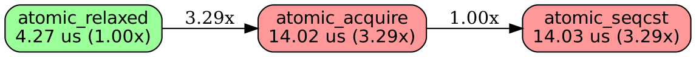

## atomic_ordering_cost/atomic_ordering_cost_n256 on macos-aarch64-c8-bare-apple

Run `20261116T074652Z-dea557ae`.

| variant | median | vs best |
|---|---|---|
| atomic_relaxed | 31 ns | 1.00x |
| atomic_acquire | 168 ns | 5.37x |
| atomic_seqcst | 170 ns | 5.46x |

## atomic_ordering_cost/atomic_ordering_cost_n4096 on macos-aarch64-c8-bare-apple

Run `20261116T074652Z-dea557ae`.

| variant | median | vs best |
|---|---|---|
| atomic_relaxed | 1.05 us | 1.00x |
| atomic_acquire | 3.53 us | 3.36x |
| atomic_seqcst | 3.53 us | 3.36x |

## atomic_ordering_cost/atomic_ordering_cost_n64 on macos-aarch64-c8-bare-apple

Run `20261116T074652Z-dea557ae`.

| variant | median | vs best |
|---|---|---|
| atomic_relaxed | 4 ns | 1.00x |
| atomic_seqcst | 4 ns | 1.00x |
| atomic_acquire | 7 ns | 1.69x |

## atomic_vs_plain/atomic_vs_plain_n1024 on linux-x86_64-c16-bare-intel

Run `20261115T021656Z-266650fb`.

| variant | median | vs best |
|---|---|---|
| acc_plain | 1.15 us | 1.00x |

## atomic_vs_plain/atomic_vs_plain_n1024 on macos-aarch64-c8-bare-apple

Run `20261116T074737Z-dea557ae`.

| variant | median | vs best |
|---|---|---|
| acc_atomic_seqcst | 1.25 us | 1.00x |
| acc_atomic_relaxed | 1.25 us | 1.00x |
| acc_plain | 1.25 us | 1.00x |

## atomic_vs_plain/atomic_vs_plain_n16384 on linux-x86_64-c16-bare-intel

Run `20261115T022201Z-266650fb-dirty`.

| variant | median | vs best |
|---|---|---|
| acc_plain | 18.27 us | 1.00x |
| acc_atomic_seqcst | 18.27 us | 1.00x |
| acc_atomic_relaxed | 18.27 us | 1.00x |

## atomic_vs_plain/atomic_vs_plain_n16384 on macos-aarch64-c8-bare-apple

Run `20261116T074737Z-dea557ae`.

| variant | median | vs best |
|---|---|---|
| acc_plain | 20.43 us | 1.00x |
| acc_atomic_seqcst | 20.44 us | 1.00x |
| acc_atomic_relaxed | 20.46 us | 1.00x |

## atomic_vs_plain/atomic_vs_plain_n256 on linux-x86_64-c16-bare-intel

Run `20261115T021420Z-266650fb-dirty`.

| variant | median | vs best |
|---|---|---|
| acc_atomic_seqcst | 292 ns | 1.00x |
| acc_atomic_relaxed | 292 ns | 1.00x |
| acc_plain | 292 ns | 1.00x |

## atomic_vs_plain/atomic_vs_plain_n256 on macos-aarch64-c8-bare-apple

Run `20261116T074737Z-dea557ae`.

| variant | median | vs best |
|---|---|---|
| acc_atomic_seqcst | 272 ns | 1.00x |
| acc_plain | 272 ns | 1.00x |
| acc_atomic_relaxed | 273 ns | 1.01x |

## atomic_vs_plain/atomic_vs_plain_n4096 on linux-x86_64-c16-bare-intel

Run `20261115T021927Z-266650fb-dirty`.

| variant | median | vs best |
|---|---|---|
| acc_plain | 4.57 us | 1.00x |
| acc_atomic_relaxed | 4.57 us | 1.00x |
| acc_atomic_seqcst | 4.57 us | 1.00x |

## atomic_vs_plain/atomic_vs_plain_n4096 on macos-aarch64-c8-bare-apple

Run `20261116T074737Z-dea557ae`.

| variant | median | vs best |
|---|---|---|
| acc_atomic_seqcst | 5.06 us | 1.00x |
| acc_plain | 5.15 us | 1.02x |
| acc_atomic_relaxed | 5.15 us | 1.02x |

## bit_count_ops/bit_count_ops_n1024 on linux-x86_64-c16-bare-intel

Run `20261115T022738Z-266650fb-dirty`.

| variant | median | vs best |
|---|---|---|
| ctz_debruijn | 52 ns | 1.00x |
| ctz_intrinsic | 52 ns | 1.00x |
| ctz_loop | 124 ns | 2.39x |

## bit_count_ops/bit_count_ops_n1024 on macos-aarch64-c8-bare-apple

Run `20261116T074820Z-dea557ae`.

| variant | median | vs best |
|---|---|---|
| ctz_debruijn | 60 ns | 1.00x |
| ctz_intrinsic | 60 ns | 1.01x |
| ctz_loop | 150 ns | 2.52x |

## bit_count_ops/bit_count_ops_n16384 on linux-x86_64-c16-bare-intel

Run `20261115T023242Z-266650fb-dirty`.

| variant | median | vs best |
|---|---|---|
| ctz_intrinsic | 620 ns | 1.00x |
| ctz_debruijn | 621 ns | 1.00x |
| ctz_loop | 2.47 us | 3.99x |

## bit_count_ops/bit_count_ops_n16384 on macos-aarch64-c8-bare-apple

Run `20261116T074820Z-dea557ae`.

| variant | median | vs best |
|---|---|---|
| ctz_debruijn | 501 ns | 1.00x |
| ctz_intrinsic | 503 ns | 1.00x |
| ctz_loop | 2.04 us | 4.07x |

## bit_count_ops/bit_count_ops_n256 on linux-x86_64-c16-bare-intel

Run `20261115T022503Z-266650fb-dirty`.

| variant | median | vs best |
|---|---|---|
| ctz_intrinsic | 16 ns | 1.00x |
| ctz_debruijn | 20 ns | 1.21x |
| ctz_loop | 38 ns | 2.28x |

## bit_count_ops/bit_count_ops_n256 on macos-aarch64-c8-bare-apple

Run `20261116T074820Z-dea557ae`.

| variant | median | vs best |
|---|---|---|
| ctz_debruijn | 15 ns | 1.00x |
| ctz_intrinsic | 15 ns | 1.00x |
| ctz_loop | 52 ns | 3.38x |

## bit_count_ops/bit_count_ops_n4096 on linux-x86_64-c16-bare-intel

Run `20261115T023010Z-266650fb-dirty`.

| variant | median | vs best |
|---|---|---|
| ctz_debruijn | 180 ns | 1.00x |
| ctz_intrinsic | 180 ns | 1.00x |
| ctz_loop | 671 ns | 3.73x |

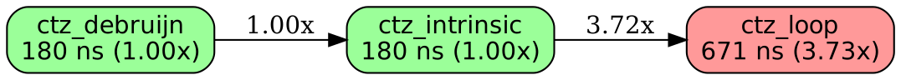

## bit_count_ops/bit_count_ops_n4096 on macos-aarch64-c8-bare-apple

Run `20261116T074820Z-dea557ae`.

| variant | median | vs best |
|---|---|---|
| ctz_debruijn | 153 ns | 1.00x |
| ctz_intrinsic | 154 ns | 1.00x |
| ctz_loop | 526 ns | 3.43x |

## bounds_check/bounds_check_n1024 on linux-x86_64-c16-bare-intel

Run `20261115T023819Z-266650fb-dirty`.

| variant | median | vs best |
|---|---|---|
| bc_iter | 152 ns | 1.00x |
| bc_index | 152 ns | 1.00x |
| bc_unchecked | 153 ns | 1.00x |

## bounds_check/bounds_check_n1024 on macos-aarch64-c8-bare-apple

Run `20261116T074859Z-dea557ae`.

| variant | median | vs best |
|---|---|---|
| bc_index | 35 ns | 1.00x |
| bc_iter | 36 ns | 1.05x |
| bc_unchecked | 39 ns | 1.14x |

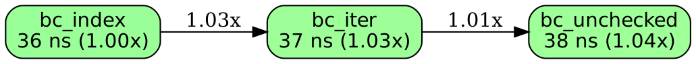

## bounds_check/bounds_check_n16384 on linux-x86_64-c16-bare-intel

Run `20261115T024323Z-266650fb-dirty`.

| variant | median | vs best |
|---|---|---|
| bc_unchecked | 2.29 us | 1.00x |
| bc_index | 2.29 us | 1.00x |
| bc_iter | 2.29 us | 1.00x |

## bounds_check/bounds_check_n16384 on macos-aarch64-c8-bare-apple

Run `20261116T074859Z-dea557ae`.

| variant | median | vs best |
|---|---|---|
| bc_index | 358 ns | 1.00x |
| bc_iter | 359 ns | 1.01x |
| bc_unchecked | 633 ns | 1.77x |

## bounds_check/bounds_check_n256 on linux-x86_64-c16-bare-intel

Run `20261115T023548Z-266650fb`.

| variant | median | vs best |
|---|---|---|
| bc_unchecked | 37 ns | 1.00x |

## bounds_check/bounds_check_n256 on macos-aarch64-c8-bare-apple

Run `20261116T074859Z-dea557ae`.

| variant | median | vs best |
|---|---|---|
| bc_index | 5 ns | 1.00x |
| bc_iter | 6 ns | 1.24x |
| bc_unchecked | 7 ns | 1.34x |

## bounds_check/bounds_check_n4096 on linux-x86_64-c16-bare-intel

Run `20261115T024051Z-266650fb-dirty`.

| variant | median | vs best |
|---|---|---|
| bc_unchecked | 580 ns | 1.00x |
| bc_index | 580 ns | 1.00x |
| bc_iter | 580 ns | 1.00x |

## bounds_check/bounds_check_n4096 on macos-aarch64-c8-bare-apple

Run `20261116T074859Z-dea557ae`.

| variant | median | vs best |
|---|---|---|
| bc_index | 93 ns | 1.00x |
| bc_iter | 94 ns | 1.01x |
| bc_unchecked | 145 ns | 1.55x |

## branch_pattern/branch_pattern_n1024 on linux-x86_64-c16-bare-intel

Run `20261115T024902Z-266650fb-dirty`.

| variant | median | vs best |
|---|---|---|
| branch_if | 861 ns | 1.00x |
| branch_cmov | 1.71 us | 1.99x |

## branch_pattern/branch_pattern_n1024 on macos-aarch64-c8-bare-apple

Run `20261116T074936Z-dea557ae`.

| variant | median | vs best |
|---|---|---|
| branch_cmov | 1.61 us | 1.00x |
| branch_if | 1.64 us | 1.01x |

## branch_pattern/branch_pattern_n16384 on linux-x86_64-c16-bare-intel

Run `20261115T025232Z-266650fb-dirty`.

| variant | median | vs best |
|---|---|---|
| branch_cmov | 27.44 us | 1.00x |
| branch_if | 29.93 us | 1.09x |

## branch_pattern/branch_pattern_n16384 on macos-aarch64-c8-bare-apple

Run `20261116T074936Z-dea557ae`.

| variant | median | vs best |
|---|---|---|
| branch_cmov | 26.07 us | 1.00x |
| branch_if | 26.07 us | 1.00x |

## branch_pattern/branch_pattern_n256 on linux-x86_64-c16-bare-intel

Run `20261115T024719Z-266650fb-dirty`.

| variant | median | vs best |
|---|---|---|
| branch_if | 221 ns | 1.00x |
| branch_cmov | 429 ns | 1.94x |

## branch_pattern/branch_pattern_n256 on macos-aarch64-c8-bare-apple

Run `20261116T074936Z-dea557ae`.

| variant | median | vs best |
|---|---|---|
| branch_cmov | 392 ns | 1.00x |
| branch_if | 392 ns | 1.00x |

## branch_pattern/branch_pattern_n4096 on linux-x86_64-c16-bare-intel

Run `20261115T025046Z-266650fb-dirty`.

| variant | median | vs best |
|---|---|---|
| branch_if | 3.15 us | 1.00x |
| branch_cmov | 6.29 us | 2.00x |

## branch_pattern/branch_pattern_n4096 on macos-aarch64-c8-bare-apple

Run `20261116T074936Z-dea557ae`.

| variant | median | vs best |
|---|---|---|
| branch_if | 6.49 us | 1.00x |
| branch_cmov | 6.49 us | 1.00x |

## branch_pattern/branch_pattern_n64 on linux-x86_64-c16-bare-intel

Run `20261115T024533Z-266650fb-dirty`.

| variant | median | vs best |
|---|---|---|
| branch_if | 63 ns | 1.00x |
| branch_cmov | 112 ns | 1.79x |

## branch_pattern/branch_pattern_n64 on macos-aarch64-c8-bare-apple

Run `20261116T074936Z-dea557ae`.

| variant | median | vs best |
|---|---|---|
| branch_cmov | 82 ns | 1.00x |
| branch_if | 83 ns | 1.01x |

## branch_predictability/branch_predictability_n1024 on linux-x86_64-c16-bare-intel

Run `20261115T025809Z-266650fb-dirty`.

| variant | median | vs best |
|---|---|---|
| bp_skew_high | 1.15 us | 1.00x |
| bp_balanced | 1.15 us | 1.00x |
| bp_skew_low | 1.15 us | 1.00x |

## branch_predictability/branch_predictability_n1024 on macos-aarch64-c8-bare-apple

Run `20261116T075016Z-dea557ae`.

| variant | median | vs best |
|---|---|---|
| bp_skew_low | 1.26 us | 1.00x |
| bp_skew_high | 1.27 us | 1.01x |
| bp_balanced | 1.28 us | 1.01x |

## branch_predictability/branch_predictability_n16384 on linux-x86_64-c16-bare-intel

Run `20261115T030315Z-266650fb-dirty`.

| variant | median | vs best |
|---|---|---|
| bp_skew_low | 18.27 us | 1.00x |
| bp_skew_high | 18.27 us | 1.00x |
| bp_balanced | 18.27 us | 1.00x |

## branch_predictability/branch_predictability_n16384 on macos-aarch64-c8-bare-apple

Run `20261116T075016Z-dea557ae`.

| variant | median | vs best |
|---|---|---|
| bp_balanced | 20.52 us | 1.00x |
| bp_skew_high | 20.54 us | 1.00x |
| bp_skew_low | 20.55 us | 1.00x |

## branch_predictability/branch_predictability_n256 on linux-x86_64-c16-bare-intel

Run `20261115T025534Z-266650fb-dirty`.

| variant | median | vs best |
|---|---|---|
| bp_skew_high | 292 ns | 1.00x |
| bp_balanced | 292 ns | 1.00x |
| bp_skew_low | 292 ns | 1.00x |

## branch_predictability/branch_predictability_n256 on macos-aarch64-c8-bare-apple

Run `20261116T075016Z-dea557ae`.

| variant | median | vs best |
|---|---|---|
| bp_balanced | 295 ns | 1.00x |
| bp_skew_high | 295 ns | 1.00x |
| bp_skew_low | 296 ns | 1.00x |

## branch_predictability/branch_predictability_n4096 on linux-x86_64-c16-bare-intel

Run `20261115T030041Z-266650fb-dirty`.

| variant | median | vs best |
|---|---|---|
| bp_skew_high | 3.75 us | 1.00x |
| bp_skew_low | 4.57 us | 1.22x |
| bp_balanced | 4.57 us | 1.22x |

## branch_predictability/branch_predictability_n4096 on macos-aarch64-c8-bare-apple

Run `20261116T075016Z-dea557ae`.

| variant | median | vs best |
|---|---|---|
| bp_balanced | 5.11 us | 1.00x |
| bp_skew_high | 5.11 us | 1.00x |
| bp_skew_low | 5.11 us | 1.00x |

## build-static/clean_n25 on linux-x86_64-c4-container-intel

Run `20261119T150158Z-ffb57e5a`.

| variant | median | vs best |
|---|---|---|
| llvm_non_incremental | 19350.54 ms | 1.00x |
| llvm_incremental | 21564.30 ms | 1.11x |

## build-static/clean_n97 on linux-x86_64-c4-container-intel

Run `20261119T171604Z-fe400621`.

| variant | median | vs best |
|---|---|---|
| llvm_non_incremental | 117220.40 ms | 1.00x |
| llvm_incremental | 126373.24 ms | 1.08x |

## build-static/leaf_n25 on linux-x86_64-c4-container-intel

Run `20261119T150158Z-ffb57e5a`.

| variant | median | vs best |
|---|---|---|
| llvm_incremental | 3920.36 ms | 1.00x |
| llvm_non_incremental | 5874.19 ms | 1.50x |

## build-static/leaf_n97 on linux-x86_64-c4-container-intel

Run `20261119T203124Z-4228372a`.

| variant | median | vs best |
|---|---|---|
| llvm_incremental | 4011.75 ms | 1.00x |
| llvm_non_incremental | 5821.77 ms | 1.45x |

## build-static/mid_n25 on linux-x86_64-c4-container-intel

Run `20261119T150158Z-ffb57e5a`.

| variant | median | vs best |
|---|---|---|
| llvm_incremental | 586.04 ms | 1.00x |
| llvm_non_incremental | 6084.57 ms | 10.38x |

## build-static/mid_n97 on linux-x86_64-c4-container-intel

Run `20261119T203124Z-4228372a`.

| variant | median | vs best |
|---|---|---|
| llvm_incremental | 2549.14 ms | 1.00x |
| llvm_non_incremental | 33358.81 ms | 13.09x |

## build-static/root_n25 on linux-x86_64-c4-container-intel

Run `20261119T150158Z-ffb57e5a`.

| variant | median | vs best |
|---|---|---|
| llvm_incremental | 1247.25 ms | 1.00x |
| llvm_non_incremental | 16745.89 ms | 13.43x |

## build-static/root_n97 on linux-x86_64-c4-container-intel

Run `20261119T203124Z-4228372a`.

| variant | median | vs best |
|---|---|---|
| llvm_incremental | 7182.84 ms | 1.00x |
| llvm_non_incremental | 89677.26 ms | 12.48x |

## cache_layout/cache_layout_n1024 on linux-x86_64-c16-bare-intel

Run `20261115T030857Z-266650fb-dirty`.

| variant | median | vs best |
|---|---|---|
| layout_soa | 28 ns | 1.00x |
| layout_aos | 28 ns | 1.00x |

## cache_layout/cache_layout_n1024 on macos-aarch64-c8-bare-apple

Run `20261116T075057Z-dea557ae`.

| variant | median | vs best |
|---|---|---|
| layout_aos | 8 ns | 1.00x |
| layout_soa | 8 ns | 1.05x |

## cache_layout/cache_layout_n16384 on linux-x86_64-c16-bare-intel

Run `20261115T031223Z-266650fb-dirty`.

| variant | median | vs best |
|---|---|---|
| layout_aos | 333 ns | 1.00x |
| layout_soa | 333 ns | 1.00x |

## cache_layout/cache_layout_n16384 on macos-aarch64-c8-bare-apple

Run `20261116T075057Z-dea557ae`.

| variant | median | vs best |
|---|---|---|
| layout_aos | 338 ns | 1.00x |
| layout_soa | 338 ns | 1.00x |

## cache_layout/cache_layout_n256 on linux-x86_64-c16-bare-intel

Run `20261115T030714Z-266650fb-dirty`.

| variant | median | vs best |
|---|---|---|
| layout_soa | 12 ns | 1.00x |
| layout_aos | 12 ns | 1.01x |

## cache_layout/cache_layout_n256 on macos-aarch64-c8-bare-apple

Run `20261116T075057Z-dea557ae`.

| variant | median | vs best |
|---|---|---|
| layout_aos | 1 ns | 1.00x |
| layout_soa | 1 ns | 1.00x |

## cache_layout/cache_layout_n4096 on linux-x86_64-c16-bare-intel

Run `20261115T031040Z-266650fb-dirty`.

| variant | median | vs best |
|---|---|---|
| layout_soa | 89 ns | 1.00x |
| layout_aos | 90 ns | 1.01x |

## cache_layout/cache_layout_n4096 on macos-aarch64-c8-bare-apple

Run `20261116T075057Z-dea557ae`.

| variant | median | vs best |
|---|---|---|
| layout_aos | 63 ns | 1.00x |
| layout_soa | 65 ns | 1.03x |

## cache_layout/cache_layout_n64 on linux-x86_64-c16-bare-intel

Run `20261115T030527Z-266650fb-dirty`.

| variant | median | vs best |
|---|---|---|
| layout_aos | 10 ns | 1.00x |
| layout_soa | 10 ns | 1.00x |

## cache_layout/cache_layout_n64 on macos-aarch64-c8-bare-apple

Run `20261116T075057Z-dea557ae`.

| variant | median | vs best |
|---|---|---|
| layout_aos | 0 ns | 1.00x |
| layout_soa | 0 ns | 1.00x |

## dep_graph_csr_9/dep_graph_csr_9_n128 on linux-x86_64-c16-bare-intel

Run `20261115T032537Z-266650fb-dirty`.

| variant | median | vs best |
|---|---|---|
| dep_graph_hybrid | 734 ns | 1.00x |
| dep_graph_csr | 746 ns | 1.02x |
| dep_graph_dense | 23.42 us | 31.93x |

## dep_graph_csr_9/dep_graph_csr_9_n128 on macos-aarch64-c8-bare-apple

Run `20261116T075133Z-dea557ae`.

| variant | median | vs best |
|---|---|---|
| dep_graph_hybrid | 754 ns | 1.00x |
| dep_graph_csr | 780 ns | 1.03x |
| dep_graph_dense | 26.46 us | 35.08x |

## dep_graph_csr_9/dep_graph_csr_9_n16 on linux-x86_64-c16-bare-intel

Run `20261115T031800Z-266650fb-dirty`.

| variant | median | vs best |
|---|---|---|
| dep_graph_csr | 89 ns | 1.00x |
| dep_graph_dense | 439 ns | 4.93x |
| dep_graph_hybrid | 447 ns | 5.02x |

## dep_graph_csr_9/dep_graph_csr_9_n16 on macos-aarch64-c8-bare-apple

Run `20261116T075133Z-dea557ae`.

| variant | median | vs best |
|---|---|---|
| dep_graph_csr | 52 ns | 1.00x |
| dep_graph_hybrid | 434 ns | 8.33x |
| dep_graph_dense | 866 ns | 16.61x |

## dep_graph_csr_9/dep_graph_csr_9_n256 on linux-x86_64-c16-bare-intel

Run `20261115T032812Z-266650fb-dirty`.

| variant | median | vs best |
|---|---|---|
| dep_graph_hybrid | 1.46 us | 1.00x |
| dep_graph_csr | 1.49 us | 1.02x |
| dep_graph_dense | 92.67 us | 63.39x |

## dep_graph_csr_9/dep_graph_csr_9_n256 on macos-aarch64-c8-bare-apple

Run `20261116T075133Z-dea557ae`.

| variant | median | vs best |
|---|---|---|
| dep_graph_hybrid | 1.57 us | 1.00x |
| dep_graph_csr | 1.63 us | 1.04x |
| dep_graph_dense | 104.01 us | 66.11x |

## dep_graph_csr_9/dep_graph_csr_9_n32 on linux-x86_64-c16-bare-intel

Run `20261115T032032Z-266650fb-dirty`.

| variant | median | vs best |
|---|---|---|
| dep_graph_csr | 193 ns | 1.00x |
| dep_graph_hybrid | 208 ns | 1.08x |
| dep_graph_dense | 1.60 us | 8.29x |

## dep_graph_csr_9/dep_graph_csr_9_n32 on macos-aarch64-c8-bare-apple

Run `20261116T075133Z-dea557ae`.

| variant | median | vs best |
|---|---|---|
| dep_graph_csr | 150 ns | 1.00x |
| dep_graph_hybrid | 155 ns | 1.04x |
| dep_graph_dense | 2.13 us | 14.24x |

## dep_graph_csr_9/dep_graph_csr_9_n64 on linux-x86_64-c16-bare-intel

Run `20261115T032304Z-266650fb-dirty`.

| variant | median | vs best |
|---|---|---|
| dep_graph_csr | 377 ns | 1.00x |
| dep_graph_hybrid | 404 ns | 1.07x |
| dep_graph_dense | 6.02 us | 15.96x |

## dep_graph_csr_9/dep_graph_csr_9_n64 on macos-aarch64-c8-bare-apple

Run `20261116T075133Z-dea557ae`.

| variant | median | vs best |
|---|---|---|
| dep_graph_csr | 359 ns | 1.00x |
| dep_graph_hybrid | 369 ns | 1.03x |
| dep_graph_dense | 7.02 us | 19.56x |

## dep_graph_csr_9/dep_graph_csr_9_n8 on linux-x86_64-c16-bare-intel

Run `20261115T031525Z-266650fb-dirty`.

| variant | median | vs best |
|---|---|---|
| dep_graph_csr | 43 ns | 1.00x |
| dep_graph_dense | 124 ns | 2.88x |
| dep_graph_hybrid | 125 ns | 2.89x |

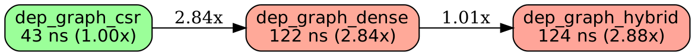

## dep_graph_csr_9/dep_graph_csr_9_n8 on macos-aarch64-c8-bare-apple

Run `20261116T075133Z-dea557ae`.

| variant | median | vs best |
|---|---|---|
| dep_graph_csr | 25 ns | 1.00x |
| dep_graph_hybrid | 102 ns | 4.00x |
| dep_graph_dense | 554 ns | 21.80x |

## dispatch_dynamic/dispatch_dynamic_n1024 on linux-x86_64-c16-bare-intel

Run `20261115T033621Z-266650fb-dirty`.

| variant | median | vs best |
|---|---|---|
| dispatch_direct | 150 ns | 1.00x |
| dispatch_volatile | 182 ns | 1.22x |
| dispatch_runtime | 193 ns | 1.29x |

## dispatch_dynamic/dispatch_dynamic_n1024 on macos-aarch64-c8-bare-apple

Run `20261116T075227Z-dea557ae`.

| variant | median | vs best |
|---|---|---|
| dispatch_direct | 110 ns | 1.00x |
| dispatch_volatile | 160 ns | 1.45x |
| dispatch_runtime | 291 ns | 2.63x |

## dispatch_dynamic/dispatch_dynamic_n16384 on linux-x86_64-c16-bare-intel

Run `20261115T034125Z-266650fb-dirty`.

| variant | median | vs best |
|---|---|---|
| dispatch_direct | 2.29 us | 1.00x |
| dispatch_volatile | 2.85 us | 1.25x |
| dispatch_runtime | 11.44 us | 5.00x |

## dispatch_dynamic/dispatch_dynamic_n16384 on macos-aarch64-c8-bare-apple

Run `20261116T075227Z-dea557ae`.

| variant | median | vs best |
|---|---|---|
| dispatch_direct | 2.51 us | 1.00x |
| dispatch_volatile | 2.56 us | 1.02x |
| dispatch_runtime | 9.86 us | 3.93x |

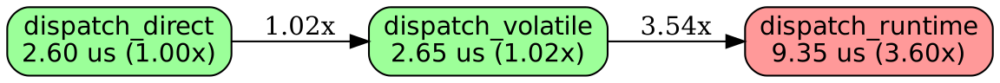

## dispatch_dynamic/dispatch_dynamic_n256 on linux-x86_64-c16-bare-intel

Run `20261115T033349Z-266650fb-dirty`.

| variant | median | vs best |
|---|---|---|
| dispatch_runtime | 41 ns | 1.00x |
| dispatch_direct | 43 ns | 1.05x |
| dispatch_volatile | 46 ns | 1.13x |

## dispatch_dynamic/dispatch_dynamic_n256 on macos-aarch64-c8-bare-apple

Run `20261116T075227Z-dea557ae`.

| variant | median | vs best |
|---|---|---|
| dispatch_direct | 10 ns | 1.00x |
| dispatch_volatile | 45 ns | 4.33x |
| dispatch_runtime | 46 ns | 4.40x |

## dispatch_dynamic/dispatch_dynamic_n4096 on linux-x86_64-c16-bare-intel

Run `20261115T033853Z-266650fb-dirty`.

| variant | median | vs best |
|---|---|---|
| dispatch_direct | 578 ns | 1.00x |
| dispatch_volatile | 718 ns | 1.24x |
| dispatch_runtime | 741 ns | 1.28x |

## dispatch_dynamic/dispatch_dynamic_n4096 on macos-aarch64-c8-bare-apple

Run `20261116T075227Z-dea557ae`.

| variant | median | vs best |
|---|---|---|
| dispatch_direct | 593 ns | 1.00x |
| dispatch_volatile | 646 ns | 1.09x |
| dispatch_runtime | 1.10 us | 1.86x |

## dispatch_dynamic/dispatch_dynamic_n64 on linux-x86_64-c16-bare-intel

Run `20261115T033114Z-266650fb-dirty`.

| variant | median | vs best |
|---|---|---|
| dispatch_runtime | 16 ns | 1.00x |
| dispatch_direct | 16 ns | 1.02x |
| dispatch_volatile | 16 ns | 1.03x |

## dispatch_dynamic/dispatch_dynamic_n64 on macos-aarch64-c8-bare-apple

Run `20261116T075227Z-dea557ae`.

| variant | median | vs best |
|---|---|---|
| dispatch_direct | 2 ns | 1.00x |
| dispatch_volatile | 8 ns | 3.57x |
| dispatch_runtime | 8 ns | 3.95x |

## dispatch_static/dispatch_static_n1024 on linux-x86_64-c16-bare-intel

Run `20261115T034930Z-266650fb-dirty`.

| variant | median | vs best |
|---|---|---|
| dispatch_const_ptr | 150 ns | 1.00x |
| dispatch_direct | 150 ns | 1.00x |
| dispatch_trait | 150 ns | 1.00x |

## dispatch_static/dispatch_static_n1024 on macos-aarch64-c8-bare-apple

Run `20261116T075315Z-dea557ae`.

| variant | median | vs best |
|---|---|---|
| dispatch_direct | 110 ns | 1.00x |
| dispatch_trait | 111 ns | 1.01x |
| dispatch_const_ptr | 111 ns | 1.01x |

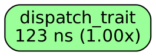

## dispatch_static/dispatch_static_n16384 on linux-x86_64-c16-bare-intel

Run `20261115T035434Z-266650fb-dirty`.

| variant | median | vs best |
|---|---|---|
| dispatch_direct | 2.29 us | 1.00x |
| dispatch_trait | 2.29 us | 1.00x |
| dispatch_const_ptr | 2.29 us | 1.00x |

## dispatch_static/dispatch_static_n16384 on macos-aarch64-c8-bare-apple

Run `20261116T075315Z-dea557ae`.

| variant | median | vs best |
|---|---|---|
| dispatch_direct | 2.51 us | 1.00x |
| dispatch_trait | 2.51 us | 1.00x |
| dispatch_const_ptr | 2.51 us | 1.00x |

## dispatch_static/dispatch_static_n256 on linux-x86_64-c16-bare-intel

Run `20261115T034658Z-266650fb-dirty`.

| variant | median | vs best |
|---|---|---|
| dispatch_const_ptr | 43 ns | 1.00x |
| dispatch_direct | 43 ns | 1.00x |
| dispatch_trait | 43 ns | 1.00x |

## dispatch_static/dispatch_static_n256 on macos-aarch64-c8-bare-apple

Run `20261116T075315Z-dea557ae`.

| variant | median | vs best |
|---|---|---|
| dispatch_const_ptr | 10 ns | 1.00x |
| dispatch_direct | 11 ns | 1.04x |
| dispatch_trait | 11 ns | 1.04x |

## dispatch_static/dispatch_static_n4096 on linux-x86_64-c16-bare-intel

Run `20261115T035202Z-266650fb-dirty`.

| variant | median | vs best |
|---|---|---|
| dispatch_const_ptr | 578 ns | 1.00x |
| dispatch_direct | 578 ns | 1.00x |
| dispatch_trait | 578 ns | 1.00x |

## dispatch_static/dispatch_static_n4096 on macos-aarch64-c8-bare-apple

Run `20261116T075315Z-dea557ae`.

| variant | median | vs best |
|---|---|---|
| dispatch_direct | 591 ns | 1.00x |
| dispatch_trait | 594 ns | 1.01x |
| dispatch_const_ptr | 597 ns | 1.01x |

## dispatch_static/dispatch_static_n64 on linux-x86_64-c16-bare-intel

Run `20261115T034423Z-266650fb-dirty`.

| variant | median | vs best |
|---|---|---|
| dispatch_const_ptr | 16 ns | 1.00x |
| dispatch_direct | 16 ns | 1.00x |
| dispatch_trait | 16 ns | 1.00x |

## dispatch_static/dispatch_static_n64 on macos-aarch64-c8-bare-apple

Run `20261116T075315Z-dea557ae`.

| variant | median | vs best |
|---|---|---|
| dispatch_const_ptr | 2 ns | 1.00x |
| dispatch_direct | 2 ns | 1.00x |
| dispatch_trait | 2 ns | 1.00x |

## ema_axis_h/ema_axis_h_n1024 on linux-x86_64-c16-bare-intel

Run `20261115T040242Z-266650fb-dirty`.

| variant | median | vs best |
|---|---|---|
| ema_scalar | 118 ns | 1.00x |
| ema_autovec | 196 ns | 1.66x |
| ema_neon | 197 ns | 1.67x |

## ema_axis_h/ema_axis_h_n1024 on macos-aarch64-c8-bare-apple

Run `20261116T075359Z-dea557ae`.

| variant | median | vs best |
|---|---|---|
| ema_neon | 42 ns | 1.00x |
| ema_scalar | 86 ns | 2.02x |
| ema_autovec | 382 ns | 8.99x |

## ema_axis_h/ema_axis_h_n16384 on linux-x86_64-c16-bare-intel

Run `20261115T040747Z-266650fb-dirty`.

| variant | median | vs best |
|---|---|---|
| ema_scalar | 1.76 us | 1.00x |
| ema_autovec | 2.93 us | 1.66x |
| ema_neon | 2.94 us | 1.67x |

## ema_axis_h/ema_axis_h_n16384 on macos-aarch64-c8-bare-apple

Run `20261116T075359Z-dea557ae`.

| variant | median | vs best |
|---|---|---|
| ema_neon | 1.50 us | 1.00x |
| ema_scalar | 1.58 us | 1.06x |
| ema_autovec | 6.53 us | 4.36x |

## ema_axis_h/ema_axis_h_n256 on linux-x86_64-c16-bare-intel

Run `20261115T040011Z-266650fb-dirty`.

| variant | median | vs best |
|---|---|---|
| ema_scalar | 36 ns | 1.00x |
| ema_autovec | 59 ns | 1.62x |
| ema_neon | 59 ns | 1.62x |

## ema_axis_h/ema_axis_h_n256 on macos-aarch64-c8-bare-apple

Run `20261116T075359Z-dea557ae`.

| variant | median | vs best |
|---|---|---|
| ema_neon | 1 ns | 1.00x |
| ema_scalar | 18 ns | 15.25x |
| ema_autovec | 79 ns | 65.58x |

## ema_axis_h/ema_axis_h_n4096 on linux-x86_64-c16-bare-intel

Run `20261115T040514Z-266650fb-dirty`.

| variant | median | vs best |
|---|---|---|
| ema_scalar | 446 ns | 1.00x |
| ema_autovec | 742 ns | 1.66x |
| ema_neon | 744 ns | 1.67x |

## ema_axis_h/ema_axis_h_n4096 on macos-aarch64-c8-bare-apple

Run `20261116T075359Z-dea557ae`.

| variant | median | vs best |
|---|---|---|
| ema_neon | 295 ns | 1.00x |
| ema_scalar | 380 ns | 1.29x |
| ema_autovec | 1.61 us | 5.46x |

## ema_axis_h/ema_axis_h_n64 on linux-x86_64-c16-bare-intel

Run `20261115T035736Z-266650fb-dirty`.

| variant | median | vs best |
|---|---|---|
| ema_neon | 12 ns | 1.00x |
| ema_autovec | 13 ns | 1.06x |
| ema_scalar | 15 ns | 1.20x |

## ema_axis_h/ema_axis_h_n64 on macos-aarch64-c8-bare-apple

Run `20261116T075359Z-dea557ae`.

| variant | median | vs best |
|---|---|---|
| ema_autovec | 0 ns | 1.00x |
| ema_neon | 0 ns | 1.00x |
| ema_scalar | 3 ns | 7.25x |

## ema_formulation/ema_formulation_n1024 on linux-x86_64-c16-bare-intel

Run `20261115T041327Z-266650fb-dirty`.

| variant | median | vs best |
|---|---|---|
| ema_form_intshift | 863 ns | 1.00x |
| ema_form_q32 | 1.43 us | 1.66x |
| ema_form_float | 2.00 us | 2.32x |

## ema_formulation/ema_formulation_n1024 on macos-aarch64-c8-bare-apple

Run `20261116T075444Z-dea557ae`.

| variant | median | vs best |
|---|---|---|
| ema_form_intshift | 1.22 us | 1.00x |
| ema_form_q32 | 1.85 us | 1.52x |
| ema_form_float | 2.09 us | 1.71x |

## ema_formulation/ema_formulation_n16384 on linux-x86_64-c16-bare-intel

Run `20261115T041834Z-266650fb-dirty`.

| variant | median | vs best |
|---|---|---|
| ema_form_intshift | 13.70 us | 1.00x |
| ema_form_q32 | 22.83 us | 1.67x |
| ema_form_float | 31.96 us | 2.33x |

## ema_formulation/ema_formulation_n16384 on macos-aarch64-c8-bare-apple

Run `20261116T075444Z-dea557ae`.

| variant | median | vs best |
|---|---|---|
| ema_form_intshift | 20.44 us | 1.00x |
| ema_form_q32 | 30.69 us | 1.50x |
| ema_form_float | 35.70 us | 1.75x |

## ema_formulation/ema_formulation_n256 on linux-x86_64-c16-bare-intel

Run `20261115T041052Z-266650fb-dirty`.

| variant | median | vs best |
|---|---|---|
| ema_form_intshift | 222 ns | 1.00x |
| ema_form_q32 | 363 ns | 1.64x |
| ema_form_float | 509 ns | 2.29x |

## ema_formulation/ema_formulation_n256 on macos-aarch64-c8-bare-apple

Run `20261116T075444Z-dea557ae`.

| variant | median | vs best |
|---|---|---|
| ema_form_intshift | 264 ns | 1.00x |
| ema_form_float | 411 ns | 1.56x |
| ema_form_q32 | 418 ns | 1.58x |

## ema_formulation/ema_formulation_n4096 on linux-x86_64-c16-bare-intel

Run `20261115T041559Z-266650fb-dirty`.

| variant | median | vs best |
|---|---|---|
| ema_form_intshift | 3.43 us | 1.00x |
| ema_form_q32 | 5.72 us | 1.67x |
| ema_form_float | 8.00 us | 2.33x |

## ema_formulation/ema_formulation_n4096 on macos-aarch64-c8-bare-apple

Run `20261116T075444Z-dea557ae`.

| variant | median | vs best |
|---|---|---|
| ema_form_intshift | 5.06 us | 1.00x |
| ema_form_q32 | 7.61 us | 1.50x |
| ema_form_float | 8.80 us | 1.74x |

## engine_vs_std/accumulator_n1048576 on macos-aarch64-c8-bare-apple

Run `20261116T075555Z-dea557ae`.

| variant | median | vs best |
|---|---|---|
| evs_std_par | 92.22 us | 1.00x |
| evs_std | 106.13 us | 1.15x |
| evs_engine_par | 231.61 us | 2.51x |
| evs_engine | 726.20 us | 7.87x |

## engine_vs_std/accumulator_n4096 on macos-aarch64-c8-bare-apple

Run `20261116T075555Z-dea557ae`.

| variant | median | vs best |
|---|---|---|
| evs_std | 408 ns | 1.00x |
| evs_engine | 13.01 us | 31.86x |
| evs_std_par | 27.15 us | 66.51x |
| evs_engine_par | 55.13 us | 135.02x |

## engine_vs_std/accumulator_n4194304 on macos-aarch64-c8-bare-apple

Run `20261116T075555Z-dea557ae`.

| variant | median | vs best |
|---|---|---|
| evs_std_par | 553.65 us | 1.00x |
| evs_std | 592.70 us | 1.07x |
| evs_engine_par | 761.92 us | 1.38x |
| evs_engine | 2.79 ms | 5.04x |

## engine_vs_std/accumulator_n65536 on macos-aarch64-c8-bare-apple

Run `20261116T075555Z-dea557ae`.

| variant | median | vs best |
|---|---|---|
| evs_std | 6.50 us | 1.00x |
| evs_std_par | 34.77 us | 5.35x |
| evs_engine | 54.61 us | 8.41x |
| evs_engine_par | 72.27 us | 11.13x |

## engine_vs_std/branching_n1048576 on macos-aarch64-c8-bare-apple

Run `20261116T075555Z-dea557ae`.

| variant | median | vs best |
|---|---|---|
| evs_std | 126.08 us | 1.00x |
| evs_engine | 335.44 us | 2.66x |

## engine_vs_std/branching_n4096 on macos-aarch64-c8-bare-apple

Run `20261116T075555Z-dea557ae`.

| variant | median | vs best |
|---|---|---|
| evs_std | 500 ns | 1.00x |
| evs_engine | 11.45 us | 22.91x |

## engine_vs_std/branching_n4194304 on macos-aarch64-c8-bare-apple

Run `20261116T075555Z-dea557ae`.

| variant | median | vs best |
|---|---|---|
| evs_std | 599.02 us | 1.00x |
| evs_engine | 2.01 ms | 3.35x |

## engine_vs_std/branching_n65536 on macos-aarch64-c8-bare-apple

Run `20261116T075555Z-dea557ae`.

| variant | median | vs best |
|---|---|---|
| evs_std | 7.76 us | 1.00x |
| evs_engine | 28.20 us | 3.63x |

## engine_vs_std/element_wise_n1048576 on macos-aarch64-c8-bare-apple

Run `20261116T075555Z-dea557ae`.

| variant | median | vs best |
|---|---|---|
| evs_std | 105.39 us | 1.00x |
| evs_engine | 108.03 us | 1.03x |

## engine_vs_std/element_wise_n4096 on macos-aarch64-c8-bare-apple

Run `20261116T075555Z-dea557ae`.

| variant | median | vs best |
|---|---|---|
| evs_std | 412 ns | 1.00x |
| evs_engine | 467 ns | 1.13x |

## engine_vs_std/element_wise_n4194304 on macos-aarch64-c8-bare-apple

Run `20261116T075555Z-dea557ae`.

| variant | median | vs best |
|---|---|---|
| evs_engine | 578.18 us | 1.00x |
| evs_std | 594.49 us | 1.03x |

## engine_vs_std/element_wise_n65536 on macos-aarch64-c8-bare-apple

Run `20261116T075555Z-dea557ae`.

| variant | median | vs best |
|---|---|---|
| evs_std | 6.55 us | 1.00x |
| evs_engine | 6.73 us | 1.03x |

## engine_vs_std/startup_accumulator_n4194304 on macos-aarch64-c8-bare-apple

Run `20261116T075555Z-dea557ae`.

| variant | median | vs best |
|---|---|---|
| evs_engine_startup | 285.15 us | 1.00x |
| evs_std_startup | 445.54 us | 1.56x |

## engine_vs_std/startup_branching_n4194304 on macos-aarch64-c8-bare-apple

Run `20261116T075555Z-dea557ae`.

| variant | median | vs best |
|---|---|---|
| evs_std_startup | 423.82 us | 1.00x |
| evs_engine_startup | 1.09 ms | 2.56x |

## engine_vs_std/startup_element_wise_n4194304 on macos-aarch64-c8-bare-apple

Run `20261116T075555Z-dea557ae`.

| variant | median | vs best |
|---|---|---|
| evs_std_startup | 429.73 us | 1.00x |
| evs_engine_startup | 1.36 ms | 3.18x |

## engine_vs_std/startup_wide_parallel_n4194304 on macos-aarch64-c8-bare-apple

Run `20261116T075555Z-dea557ae`.

| variant | median | vs best |
|---|---|---|
| evs_std_startup | 2.02 ms | 1.00x |
| evs_engine_startup | 2.22 ms | 1.10x |

## engine_vs_std/wide_parallel_n1048576 on macos-aarch64-c8-bare-apple

Run `20261116T075555Z-dea557ae`.

| variant | median | vs best |
|---|---|---|
| evs_std_par | 1.10 ms | 1.00x |
| evs_engine_par | 1.14 ms | 1.04x |
| evs_std | 2.98 ms | 2.71x |
| evs_engine | 3.02 ms | 2.74x |

## engine_vs_std/wide_parallel_n4096 on macos-aarch64-c8-bare-apple

Run `20261116T075555Z-dea557ae`.

| variant | median | vs best |
|---|---|---|
| evs_std | 11.85 us | 1.00x |
| evs_engine | 22.41 us | 1.89x |
| evs_std_par | 28.87 us | 2.44x |
| evs_engine_par | 59.58 us | 5.03x |

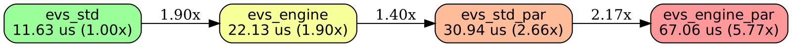

## engine_vs_std/wide_parallel_n4194304 on macos-aarch64-c8-bare-apple

Run `20261116T075555Z-dea557ae`.

| variant | median | vs best |
|---|---|---|
| evs_std_par | 4.10 ms | 1.00x |
| evs_engine_par | 4.44 ms | 1.08x |
| evs_std | 12.08 ms | 2.95x |
| evs_engine | 12.16 ms | 2.97x |

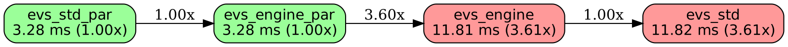

## engine_vs_std/wide_parallel_n65536 on macos-aarch64-c8-bare-apple

Run `20261116T075555Z-dea557ae`.

| variant | median | vs best |
|---|---|---|
| evs_std_par | 110.44 us | 1.00x |
| evs_engine_par | 115.83 us | 1.05x |
| evs_std | 189.40 us | 1.71x |
| evs_engine | 197.55 us | 1.79x |

## fiber_theory/fiber_theory_n16 on linux-x86_64-c16-bare-intel

Run `20261115T042302Z-266650fb-dirty`.

| variant | median | vs best |
|---|---|---|
| fib_greedy | 95 ns | 1.00x |
| fib_spectral | 72.54 us | 761.22x |

## fiber_theory/fiber_theory_n16 on macos-aarch64-c8-bare-apple

Run `20261116T075943Z-dea557ae`.

| variant | median | vs best |
|---|---|---|
| fib_greedy | 95 ns | 1.00x |
| fib_spectral | 65.69 us | 688.54x |

## fiber_theory/fiber_theory_n32 on linux-x86_64-c16-bare-intel

Run `20261115T042449Z-266650fb-dirty`.

| variant | median | vs best |
|---|---|---|
| fib_greedy | 191 ns | 1.00x |
| fib_spectral | 86.81 us | 455.22x |

## fiber_theory/fiber_theory_n32 on macos-aarch64-c8-bare-apple

Run `20261116T075943Z-dea557ae`.

| variant | median | vs best |
|---|---|---|
| fib_greedy | 185 ns | 1.00x |
| fib_spectral | 82.10 us | 442.80x |

## fiber_theory/fiber_theory_n64 on linux-x86_64-c16-bare-intel

Run `20261115T042637Z-266650fb-dirty`.

| variant | median | vs best |
|---|---|---|
| fib_greedy | 401 ns | 1.00x |
| fib_spectral | 113.57 us | 282.93x |

## fiber_theory/fiber_theory_n64 on macos-aarch64-c8-bare-apple

Run `20261116T075943Z-dea557ae`.

| variant | median | vs best |
|---|---|---|
| fib_greedy | 387 ns | 1.00x |
| fib_spectral | 127.41 us | 329.15x |

## fiber_theory/fiber_theory_n8 on linux-x86_64-c16-bare-intel

Run `20261115T042113Z-266650fb-dirty`.

| variant | median | vs best |
|---|---|---|
| fib_greedy | 50 ns | 1.00x |
| fib_spectral | 16.08 us | 320.29x |

## fiber_theory/fiber_theory_n8 on macos-aarch64-c8-bare-apple

Run `20261116T075943Z-dea557ae`.

| variant | median | vs best |
|---|---|---|
| fib_greedy | 35 ns | 1.00x |
| fib_spectral | 16.85 us | 487.02x |

## float_width/float_width_n1024 on linux-x86_64-c16-bare-intel

Run `20261115T043214Z-266650fb-dirty`.

| variant | median | vs best |
|---|---|---|
| float_i64_scaled | 578 ns | 1.00x |
| float_f64 | 2.53 us | 4.38x |
| float_f32 | 2.57 us | 4.44x |

## float_width/float_width_n1024 on macos-aarch64-c8-bare-apple

Run `20261116T080036Z-dea557ae`.

| variant | median | vs best |
|---|---|---|
| float_f32 | 255 ns | 1.00x |
| float_f64 | 318 ns | 1.24x |
| float_i64_scaled | 432 ns | 1.69x |

## float_width/float_width_n16384 on linux-x86_64-c16-bare-intel

Run `20261115T043721Z-266650fb-dirty`.

| variant | median | vs best |
|---|---|---|
| float_i64_scaled | 9.14 us | 1.00x |
| float_f32 | 40.51 us | 4.43x |
| float_f64 | 40.51 us | 4.43x |

## float_width/float_width_n16384 on macos-aarch64-c8-bare-apple

Run `20261116T080036Z-dea557ae`.

| variant | median | vs best |
|---|---|---|
| float_f32 | 5.15 us | 1.00x |
| float_f64 | 5.23 us | 1.01x |
| float_i64_scaled | 6.55 us | 1.27x |

## float_width/float_width_n256 on linux-x86_64-c16-bare-intel

Run `20261115T042939Z-266650fb-dirty`.

| variant | median | vs best |
|---|---|---|
| float_i64_scaled | 151 ns | 1.00x |
| float_f32 | 527 ns | 3.49x |
| float_f64 | 532 ns | 3.52x |

## float_width/float_width_n256 on macos-aarch64-c8-bare-apple

Run `20261116T080036Z-dea557ae`.

| variant | median | vs best |
|---|---|---|
| float_f32 | 47 ns | 1.00x |
| float_f64 | 76 ns | 1.61x |
| float_i64_scaled | 122 ns | 2.60x |

## float_width/float_width_n4096 on linux-x86_64-c16-bare-intel

Run `20261115T043446Z-266650fb-dirty`.

| variant | median | vs best |
|---|---|---|
| float_i64_scaled | 2.29 us | 1.00x |
| float_f32 | 10.41 us | 4.55x |
| float_f64 | 10.55 us | 4.61x |

## float_width/float_width_n4096 on macos-aarch64-c8-bare-apple

Run `20261116T080036Z-dea557ae`.

| variant | median | vs best |
|---|---|---|
| float_f32 | 1.23 us | 1.00x |
| float_f64 | 1.30 us | 1.05x |
| float_i64_scaled | 1.65 us | 1.34x |

## fnptr_table_dispatch/fnptr_table_dispatch_n1024 on linux-x86_64-c16-bare-intel

Run `20261115T044118Z-266650fb`.

| variant | median | vs best |
|---|---|---|
| fpt_table_16 | 178 ns | 1.00x |

## fnptr_table_dispatch/fnptr_table_dispatch_n1024 on macos-aarch64-c8-bare-apple

Run `20261116T080118Z-dea557ae`.

| variant | median | vs best |
|---|---|---|
| fpt_match_16 | 213 ns | 1.00x |
| fpt_table_16 | 325 ns | 1.52x |

## fnptr_table_dispatch/fnptr_table_dispatch_n16384 on linux-x86_64-c16-bare-intel

Run `20261115T044445Z-266650fb-dirty`.

| variant | median | vs best |
|---|---|---|
| fpt_match_16 | 12.99 us | 1.00x |
| fpt_table_16 | 15.12 us | 1.16x |

## fnptr_table_dispatch/fnptr_table_dispatch_n16384 on macos-aarch64-c8-bare-apple

Run `20261116T080118Z-dea557ae`.

| variant | median | vs best |
|---|---|---|
| fpt_match_16 | 10.09 us | 1.00x |
| fpt_table_16 | 11.38 us | 1.13x |

## fnptr_table_dispatch/fnptr_table_dispatch_n256 on linux-x86_64-c16-bare-intel

Run `20261115T043931Z-266650fb-dirty`.

| variant | median | vs best |
|---|---|---|
| fpt_table_16 | 30 ns | 1.00x |
| fpt_match_16 | 34 ns | 1.13x |

## fnptr_table_dispatch/fnptr_table_dispatch_n256 on macos-aarch64-c8-bare-apple

Run `20261116T080118Z-dea557ae`.

| variant | median | vs best |
|---|---|---|
| fpt_table_16 | 44 ns | 1.00x |
| fpt_match_16 | 65 ns | 1.47x |

## fnptr_table_dispatch/fnptr_table_dispatch_n4096 on linux-x86_64-c16-bare-intel

Run `20261115T044301Z-266650fb-dirty`.

| variant | median | vs best |
|---|---|---|
| fpt_match_16 | 590 ns | 1.00x |
| fpt_table_16 | 1.99 us | 3.36x |

## fnptr_table_dispatch/fnptr_table_dispatch_n4096 on macos-aarch64-c8-bare-apple

Run `20261116T080118Z-dea557ae`.

| variant | median | vs best |
|---|---|---|
| fpt_match_16 | 805 ns | 1.00x |
| fpt_table_16 | 1.27 us | 1.58x |

## fold_strategy/fold_strategy_n1024 on linux-x86_64-c16-bare-intel

Run `20261115T045022Z-266650fb-dirty`.

| variant | median | vs best |
|---|---|---|
| fold_quad | 45 ns | 1.00x |
| fold_paired | 79 ns | 1.76x |
| fold_sequential | 150 ns | 3.31x |

## fold_strategy/fold_strategy_n1024 on macos-aarch64-c8-bare-apple

Run `20261116T080201Z-dea557ae`.

| variant | median | vs best |
|---|---|---|
| fold_quad | 54 ns | 1.00x |
| fold_paired | 69 ns | 1.28x |
| fold_sequential | 108 ns | 2.00x |

## fold_strategy/fold_strategy_n16384 on linux-x86_64-c16-bare-intel

Run `20261115T045526Z-266650fb-dirty`.

| variant | median | vs best |
|---|---|---|
| fold_quad | 580 ns | 1.00x |
| fold_paired | 1.15 us | 1.98x |
| fold_sequential | 2.29 us | 3.94x |

## fold_strategy/fold_strategy_n16384 on macos-aarch64-c8-bare-apple

Run `20261116T080201Z-dea557ae`.

| variant | median | vs best |
|---|---|---|
| fold_quad | 671 ns | 1.00x |
| fold_paired | 1.29 us | 1.93x |
| fold_sequential | 2.55 us | 3.81x |

## fold_strategy/fold_strategy_n256 on linux-x86_64-c16-bare-intel

Run `20261115T044747Z-266650fb-dirty`.

| variant | median | vs best |
|---|---|---|
| fold_quad | 21 ns | 1.00x |
| fold_paired | 26 ns | 1.23x |
| fold_sequential | 43 ns | 2.03x |

## fold_strategy/fold_strategy_n256 on macos-aarch64-c8-bare-apple

Run `20261116T080201Z-dea557ae`.

| variant | median | vs best |
|---|---|---|
| fold_quad | 10 ns | 1.00x |
| fold_paired | 10 ns | 1.04x |
| fold_sequential | 10 ns | 1.04x |

## fold_strategy/fold_strategy_n4096 on linux-x86_64-c16-bare-intel

Run `20261115T045253Z-266650fb-dirty`.

| variant | median | vs best |
|---|---|---|
| fold_quad | 152 ns | 1.00x |
| fold_paired | 294 ns | 1.93x |
| fold_sequential | 578 ns | 3.79x |

## fold_strategy/fold_strategy_n4096 on macos-aarch64-c8-bare-apple

Run `20261116T080201Z-dea557ae`.

| variant | median | vs best |
|---|---|---|
| fold_quad | 180 ns | 1.00x |
| fold_paired | 317 ns | 1.76x |
| fold_sequential | 600 ns | 3.32x |

## frame_wide/heavy_n1048576 on macos-aarch64-c8-bare-apple

Run `20261116T080453Z-dea557ae`.

| variant | median | vs best |
|---|---|---|
| rust_std_par | 3.06 ms | 1.00x |
| hand_par | 3.51 ms | 1.15x |
| engine_par | 8.32 ms | 2.72x |
| rust_nostd | 9.57 ms | 3.12x |
| rust_std | 9.68 ms | 3.16x |
| engine | 9.73 ms | 3.18x |
| hand | 13.69 ms | 4.47x |

## frame_wide/heavy_n16777216 on macos-aarch64-c8-bare-apple

Run `20261116T080453Z-dea557ae`.

| variant | median | vs best |
|---|---|---|
| rust_std_par | 50.20 ms | 1.00x |
| hand_par | 52.50 ms | 1.05x |
| engine_par | 130.13 ms | 2.59x |
| rust_nostd | 152.37 ms | 3.04x |
| engine | 153.99 ms | 3.07x |
| rust_std | 154.40 ms | 3.08x |
| hand | 218.90 ms | 4.36x |

## frame_wide/heavy_n4194304 on macos-aarch64-c8-bare-apple

Run `20261116T080453Z-dea557ae`.

| variant | median | vs best |
|---|---|---|
| rust_std_par | 13.73 ms | 1.00x |
| hand_par | 14.37 ms | 1.05x |
| engine_par | 33.21 ms | 2.42x |
| rust_nostd | 38.32 ms | 2.79x |
| rust_std | 38.68 ms | 2.82x |
| engine | 38.97 ms | 2.84x |
| hand | 55.06 ms | 4.01x |

## frame_wide/heavy_n65536 on macos-aarch64-c8-bare-apple

Run `20261116T080453Z-dea557ae`.

| variant | median | vs best |
|---|---|---|
| rust_std_par | 218.49 us | 1.00x |
| hand_par | 255.48 us | 1.17x |
| engine_par | 550.52 us | 2.52x |
| rust_nostd | 591.63 us | 2.71x |
| rust_std | 596.58 us | 2.73x |
| engine | 603.90 us | 2.76x |
| hand | 854.90 us | 3.91x |

## frame_wide/light_n1048576 on macos-aarch64-c8-bare-apple

Run `20261116T080453Z-dea557ae`.

| variant | median | vs best |
|---|---|---|
| hand_par | 241.71 us | 1.00x |
| hand | 271.49 us | 1.12x |
| rust_std_par | 1.25 ms | 5.17x |
| rust_std | 1.48 ms | 6.11x |
| rust_nostd | 1.71 ms | 7.07x |
| engine | 1.86 ms | 7.69x |
| engine_par | 1.88 ms | 7.77x |

## frame_wide/light_n16777216 on macos-aarch64-c8-bare-apple

Run `20261116T080453Z-dea557ae`.

| variant | median | vs best |
|---|---|---|
| hand | 8.09 ms | 1.00x |
| hand_par | 8.39 ms | 1.04x |
| rust_std | 30.39 ms | 3.76x |
| rust_nostd | 30.43 ms | 3.76x |
| engine_par | 32.55 ms | 4.02x |
| engine | 33.71 ms | 4.17x |
| rust_std_par | 44.74 ms | 5.53x |

## frame_wide/light_n4194304 on macos-aarch64-c8-bare-apple

Run `20261116T080453Z-dea557ae`.

| variant | median | vs best |
|---|---|---|
| hand | 2.12 ms | 1.00x |
| hand_par | 2.18 ms | 1.03x |
| rust_std | 7.62 ms | 3.60x |
| engine_par | 8.13 ms | 3.84x |
| rust_nostd | 8.17 ms | 3.85x |
| engine | 8.53 ms | 4.03x |
| rust_std_par | 10.59 ms | 5.00x |

## frame_wide/light_n65536 on macos-aarch64-c8-bare-apple

Run `20261116T080453Z-dea557ae`.

| variant | median | vs best |
|---|---|---|
| hand | 15.24 us | 1.00x |
| hand_par | 46.88 us | 3.08x |
| rust_nostd | 71.67 us | 4.70x |
| rust_std | 72.64 us | 4.77x |
| rust_std_par | 78.53 us | 5.15x |
| engine | 79.70 us | 5.23x |
| engine_par | 106.45 us | 6.99x |

## fxpmul_strategy/fxpmul_strategy_n1024 on linux-x86_64-c16-bare-intel

Run `20261115T050123Z-266650fb-dirty`.

| variant | median | vs best |
|---|---|---|
| fxpmul_hot | 97 ns | 1.00x |
| fxpmul_precise | 151 ns | 1.55x |

## fxpmul_strategy/fxpmul_strategy_n1024 on macos-aarch64-c8-bare-apple

Run `20261116T082026Z-dea557ae`.

| variant | median | vs best |
|---|---|---|
| fxpmul_hot | 95 ns | 1.00x |
| fxpmul_precise | 110 ns | 1.16x |

## fxpmul_strategy/fxpmul_strategy_n16384 on linux-x86_64-c16-bare-intel

Run `20261115T050449Z-266650fb-dirty`.

| variant | median | vs best |
|---|---|---|
| fxpmul_hot | 1.43 us | 1.00x |
| fxpmul_precise | 2.29 us | 1.60x |

## fxpmul_strategy/fxpmul_strategy_n16384 on macos-aarch64-c8-bare-apple

Run `20261116T082026Z-dea557ae`.

| variant | median | vs best |
|---|---|---|
| fxpmul_hot | 1.62 us | 1.00x |
| fxpmul_precise | 1.94 us | 1.20x |

## fxpmul_strategy/fxpmul_strategy_n256 on linux-x86_64-c16-bare-intel

Run `20261115T045940Z-266650fb-dirty`.

| variant | median | vs best |
|---|---|---|
| fxpmul_hot | 30 ns | 1.00x |
| fxpmul_precise | 44 ns | 1.44x |

## fxpmul_strategy/fxpmul_strategy_n256 on macos-aarch64-c8-bare-apple

Run `20261116T082026Z-dea557ae`.

| variant | median | vs best |
|---|---|---|
| fxpmul_hot | 13 ns | 1.00x |
| fxpmul_precise | 19 ns | 1.41x |

## fxpmul_strategy/fxpmul_strategy_n4096 on linux-x86_64-c16-bare-intel

Run `20261115T050306Z-266650fb-dirty`.

| variant | median | vs best |
|---|---|---|
| fxpmul_hot | 364 ns | 1.00x |
| fxpmul_precise | 578 ns | 1.59x |

## fxpmul_strategy/fxpmul_strategy_n4096 on macos-aarch64-c8-bare-apple

Run `20261116T082026Z-dea557ae`.

| variant | median | vs best |
|---|---|---|
| fxpmul_hot | 394 ns | 1.00x |
| fxpmul_precise | 477 ns | 1.21x |

## fxpmul_strategy/fxpmul_strategy_n64 on linux-x86_64-c16-bare-intel

Run `20261115T045753Z-266650fb-dirty`.

| variant | median | vs best |
|---|---|---|
| fxpmul_hot | 14 ns | 1.00x |
| fxpmul_precise | 17 ns | 1.25x |

## fxpmul_strategy/fxpmul_strategy_n64 on macos-aarch64-c8-bare-apple

Run `20261116T082026Z-dea557ae`.

| variant | median | vs best |
|---|---|---|
| fxpmul_hot | 5 ns | 1.00x |
| fxpmul_precise | 5 ns | 1.04x |

## hash_algos/hash_algos_n1024 on linux-x86_64-c16-bare-intel

Run `20261115T051258Z-266650fb-dirty`.

| variant | median | vs best |
|---|---|---|
| hash_xxh | 190 ns | 1.00x |
| hash_sip | 202 ns | 1.06x |
| hash_fnv1a | 1.15 us | 6.03x |

## hash_algos/hash_algos_n1024 on macos-aarch64-c8-bare-apple

Run `20261116T082110Z-dea557ae`.

| variant | median | vs best |
|---|---|---|
| hash_xxh | 233 ns | 1.00x |
| hash_sip | 274 ns | 1.18x |
| hash_fnv1a | 1.25 us | 5.38x |

## hash_algos/hash_algos_n16384 on linux-x86_64-c16-bare-intel

Run `20261115T051803Z-266650fb-dirty`.

| variant | median | vs best |
|---|---|---|
| hash_xxh | 2.86 us | 1.00x |
| hash_sip | 3.07 us | 1.07x |
| hash_fnv1a | 18.27 us | 6.39x |

## hash_algos/hash_algos_n16384 on macos-aarch64-c8-bare-apple

Run `20261116T082110Z-dea557ae`.

| variant | median | vs best |
|---|---|---|
| hash_sip | 4.62 us | 1.00x |
| hash_xxh | 4.75 us | 1.03x |
| hash_fnv1a | 20.46 us | 4.43x |

## hash_algos/hash_algos_n256 on linux-x86_64-c16-bare-intel

Run `20261115T051026Z-266650fb-dirty`.

| variant | median | vs best |
|---|---|---|
| hash_xxh | 52 ns | 1.00x |
| hash_sip | 58 ns | 1.13x |
| hash_fnv1a | 292 ns | 5.65x |

## hash_algos/hash_algos_n256 on macos-aarch64-c8-bare-apple

Run `20261116T082110Z-dea557ae`.

| variant | median | vs best |
|---|---|---|
| hash_xxh | 32 ns | 1.00x |
| hash_sip | 58 ns | 1.84x |
| hash_fnv1a | 272 ns | 8.60x |

## hash_algos/hash_algos_n4096 on linux-x86_64-c16-bare-intel

Run `20261115T051530Z-266650fb-dirty`.

| variant | median | vs best |
|---|---|---|
| hash_xxh | 725 ns | 1.00x |
| hash_sip | 782 ns | 1.08x |
| hash_fnv1a | 4.57 us | 6.30x |

## hash_algos/hash_algos_n4096 on macos-aarch64-c8-bare-apple

Run `20261116T082110Z-dea557ae`.

| variant | median | vs best |
|---|---|---|
| hash_xxh | 1.09 us | 1.00x |
| hash_sip | 1.14 us | 1.05x |
| hash_fnv1a | 5.16 us | 4.74x |

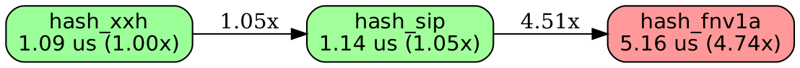

## hash_algos/hash_algos_n64 on linux-x86_64-c16-bare-intel

Run `20261115T050751Z-266650fb-dirty`.

| variant | median | vs best |
|---|---|---|
| hash_xxh | 19 ns | 1.00x |
| hash_sip | 22 ns | 1.21x |
| hash_fnv1a | 78 ns | 4.19x |

## hash_algos/hash_algos_n64 on macos-aarch64-c8-bare-apple

Run `20261116T082110Z-dea557ae`.

| variant | median | vs best |
|---|---|---|
| hash_xxh | 4 ns | 1.00x |
| hash_sip | 8 ns | 2.14x |
| hash_fnv1a | 36 ns | 9.68x |

## inline_strategy/inline_strategy_n1024 on linux-x86_64-c16-bare-intel

Run `20261115T052342Z-266650fb-dirty`.

| variant | median | vs best |
|---|---|---|
| inline_always | 1.15 us | 1.00x |
| inline_default | 1.15 us | 1.00x |
| inline_never | 1.15 us | 1.00x |

## inline_strategy/inline_strategy_n1024 on macos-aarch64-c8-bare-apple

Run `20261116T082201Z-dea557ae`.

| variant | median | vs best |
|---|---|---|
| inline_always | 1.25 us | 1.00x |
| inline_default | 1.25 us | 1.00x |
| inline_never | 1.31 us | 1.04x |

## inline_strategy/inline_strategy_n16384 on linux-x86_64-c16-bare-intel

Run `20261115T052848Z-266650fb-dirty`.

| variant | median | vs best |
|---|---|---|
| inline_default | 18.27 us | 1.00x |
| inline_always | 18.27 us | 1.00x |
| inline_never | 18.27 us | 1.00x |

## inline_strategy/inline_strategy_n16384 on macos-aarch64-c8-bare-apple

Run `20261116T082201Z-dea557ae`.

| variant | median | vs best |
|---|---|---|
| inline_default | 20.84 us | 1.00x |
| inline_always | 20.85 us | 1.00x |
| inline_never | 20.93 us | 1.00x |

## inline_strategy/inline_strategy_n256 on linux-x86_64-c16-bare-intel

Run `20261115T052107Z-266650fb-dirty`.

| variant | median | vs best |
|---|---|---|
| inline_always | 292 ns | 1.00x |
| inline_default | 292 ns | 1.00x |
| inline_never | 293 ns | 1.00x |

## inline_strategy/inline_strategy_n256 on macos-aarch64-c8-bare-apple

Run `20261116T082201Z-dea557ae`.

| variant | median | vs best |
|---|---|---|
| inline_always | 273 ns | 1.00x |
| inline_default | 274 ns | 1.00x |
| inline_never | 324 ns | 1.19x |

## inline_strategy/inline_strategy_n4096 on linux-x86_64-c16-bare-intel

Run `20261115T052615Z-266650fb`.

| variant | median | vs best |
|---|---|---|
| inline_never | 4.57 us | 1.00x |

## inline_strategy/inline_strategy_n4096 on macos-aarch64-c8-bare-apple

Run `20261116T082201Z-dea557ae`.

| variant | median | vs best |
|---|---|---|
| inline_always | 5.16 us | 1.00x |
| inline_default | 5.17 us | 1.00x |
| inline_never | 5.25 us | 1.02x |

## iter_patterns/iter_patterns_n1024 on linux-x86_64-c16-bare-intel

Run `20261115T053425Z-266650fb-dirty`.

| variant | median | vs best |
|---|---|---|
| iter_strided | 25 ns | 1.00x |
| iter_seq | 150 ns | 5.93x |
| iter_gather | 297 ns | 11.80x |

## iter_patterns/iter_patterns_n1024 on macos-aarch64-c8-bare-apple

Run `20261116T082251Z-dea557ae`.

| variant | median | vs best |
|---|---|---|
| iter_strided | 4 ns | 1.00x |
| iter_seq | 110 ns | 29.84x |
| iter_gather | 255 ns | 68.81x |

## iter_patterns/iter_patterns_n16384 on linux-x86_64-c16-bare-intel

Run `20261115T053929Z-266650fb-dirty`.

| variant | median | vs best |
|---|---|---|
| iter_strided | 292 ns | 1.00x |
| iter_seq | 2.29 us | 7.83x |
| iter_gather | 4.63 us | 15.86x |

## iter_patterns/iter_patterns_n16384 on macos-aarch64-c8-bare-apple

Run `20261116T082251Z-dea557ae`.

| variant | median | vs best |
|---|---|---|
| iter_strided | 276 ns | 1.00x |
| iter_seq | 2.56 us | 9.28x |
| iter_gather | 4.67 us | 16.95x |

## iter_patterns/iter_patterns_n256 on linux-x86_64-c16-bare-intel

Run `20261115T053150Z-266650fb-dirty`.

| variant | median | vs best |
|---|---|---|
| iter_strided | 12 ns | 1.00x |
| iter_seq | 43 ns | 3.71x |
| iter_gather | 82 ns | 7.10x |

## iter_patterns/iter_patterns_n256 on macos-aarch64-c8-bare-apple

Run `20261116T082251Z-dea557ae`.

| variant | median | vs best |
|---|---|---|
| iter_strided | 1 ns | 1.00x |
| iter_seq | 10 ns | 13.00x |
| iter_gather | 44 ns | 55.25x |

## iter_patterns/iter_patterns_n4096 on linux-x86_64-c16-bare-intel

Run `20261115T053657Z-266650fb-dirty`.

| variant | median | vs best |
|---|---|---|
| iter_strided | 78 ns | 1.00x |
| iter_seq | 577 ns | 7.36x |
| iter_gather | 1.16 us | 14.85x |

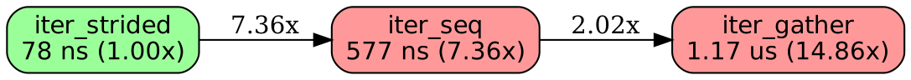

## iter_patterns/iter_patterns_n4096 on macos-aarch64-c8-bare-apple

Run `20261116T082251Z-dea557ae`.

| variant | median | vs best |
|---|---|---|
| iter_strided | 52 ns | 1.00x |
| iter_seq | 603 ns | 11.52x |
| iter_gather | 1.12 us | 21.33x |

## link-static/dev_n25 on linux-x86_64-c4-container-intel

Run `20261119T144616Z-6c89a959`.

| variant | median | vs best |
|---|---|---|
| default_replay | 78.47 ms | 1.00x |
| default_relink | 186.70 ms | 2.38x |

## link-static/dev_n97 on linux-x86_64-c4-container-intel

Run `20261119T222847Z-2eb71914`.

| variant | median | vs best |
|---|---|---|
| default_replay | 295.63 ms | 1.00x |
| default_relink | 510.24 ms | 1.73x |

## link-static/release_n25 on linux-x86_64-c4-container-intel

Run `20261119T144616Z-6c89a959`.

| variant | median | vs best |
|---|---|---|
| default_replay | 72.02 ms | 1.00x |
| default_relink | 161.64 ms | 2.24x |

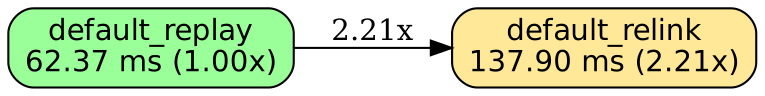

## load_alignment/load_alignment_n1024 on linux-x86_64-c16-bare-intel

Run `20261115T054506Z-266650fb-dirty`.

| variant | median | vs best |
|---|---|---|
| load_aligned | 150 ns | 1.00x |
| load_byte_pack | 150 ns | 1.00x |
| load_unaligned | 150 ns | 1.00x |

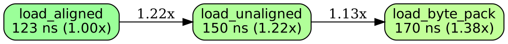

## load_alignment/load_alignment_n1024 on macos-aarch64-c8-bare-apple

Run `20261116T082337Z-dea557ae`.

| variant | median | vs best |
|---|---|---|
| load_byte_pack | 109 ns | 1.00x |
| load_unaligned | 109 ns | 1.00x |
| load_aligned | 110 ns | 1.01x |

## load_alignment/load_alignment_n16384 on linux-x86_64-c16-bare-intel

Run `20261115T055010Z-266650fb-dirty`.

| variant | median | vs best |
|---|---|---|
| load_aligned | 2.29 us | 1.00x |
| load_byte_pack | 2.29 us | 1.00x |
| load_unaligned | 2.29 us | 1.00x |

## load_alignment/load_alignment_n16384 on macos-aarch64-c8-bare-apple

Run `20261116T082337Z-dea557ae`.

| variant | median | vs best |
|---|---|---|
| load_byte_pack | 2.56 us | 1.00x |
| load_unaligned | 2.56 us | 1.00x |
| load_aligned | 2.56 us | 1.00x |

## load_alignment/load_alignment_n256 on linux-x86_64-c16-bare-intel

Run `20261115T054231Z-266650fb-dirty`.

| variant | median | vs best |
|---|---|---|
| load_aligned | 43 ns | 1.00x |
| load_byte_pack | 43 ns | 1.00x |
| load_unaligned | 43 ns | 1.00x |

## load_alignment/load_alignment_n256 on macos-aarch64-c8-bare-apple

Run `20261116T082337Z-dea557ae`.

| variant | median | vs best |
|---|---|---|
| load_aligned | 11 ns | 1.00x |
| load_byte_pack | 11 ns | 1.00x |
| load_unaligned | 11 ns | 1.00x |

## load_alignment/load_alignment_n4096 on linux-x86_64-c16-bare-intel

Run `20261115T054738Z-266650fb-dirty`.

| variant | median | vs best |
|---|---|---|
| load_aligned | 578 ns | 1.00x |
| load_byte_pack | 578 ns | 1.00x |
| load_unaligned | 578 ns | 1.00x |

## load_alignment/load_alignment_n4096 on macos-aarch64-c8-bare-apple

Run `20261116T082337Z-dea557ae`.

| variant | median | vs best |
|---|---|---|
| load_unaligned | 602 ns | 1.00x |
| load_byte_pack | 602 ns | 1.00x |
| load_aligned | 602 ns | 1.00x |

## match_arm_count/match_arm_count_n1024 on linux-x86_64-c16-bare-intel

Run `20261115T055547Z-266650fb-dirty`.

| variant | median | vs best |
|---|---|---|
| match_2_arms | 106 ns | 1.00x |
| match_8_arms | 161 ns | 1.51x |
| match_64_arms | 181 ns | 1.70x |

## match_arm_count/match_arm_count_n1024 on macos-aarch64-c8-bare-apple

Run `20261116T082613Z-dea557ae`.

| variant | median | vs best |
|---|---|---|
| match_2_arms | 100 ns | 1.00x |
| match_8_arms | 160 ns | 1.61x |
| match_64_arms | 237 ns | 2.38x |

## match_arm_count/match_arm_count_n16384 on linux-x86_64-c16-bare-intel

Run `20261115T060052Z-266650fb-dirty`.

| variant | median | vs best |
|---|---|---|
| match_2_arms | 1.58 us | 1.00x |
| match_64_arms | 11.31 us | 7.17x |
| match_8_arms | 11.37 us | 7.21x |

## match_arm_count/match_arm_count_n16384 on macos-aarch64-c8-bare-apple

Run `20261116T082613Z-dea557ae`.

| variant | median | vs best |
|---|---|---|
| match_2_arms | 1.38 us | 1.00x |
| match_8_arms | 2.52 us | 1.83x |
| match_64_arms | 12.88 us | 9.34x |

## match_arm_count/match_arm_count_n256 on linux-x86_64-c16-bare-intel

Run `20261115T055312Z-266650fb-dirty`.

| variant | median | vs best |
|---|---|---|
| match_8_arms | 30 ns | 1.00x |
| match_2_arms | 33 ns | 1.08x |
| match_64_arms | 39 ns | 1.29x |

## match_arm_count/match_arm_count_n256 on macos-aarch64-c8-bare-apple

Run `20261116T082613Z-dea557ae`.

| variant | median | vs best |
|---|---|---|
| match_2_arms | 20 ns | 1.00x |
| match_64_arms | 71 ns | 3.54x |
| match_8_arms | 95 ns | 4.76x |

## match_arm_count/match_arm_count_n4096 on linux-x86_64-c16-bare-intel

Run `20261115T055819Z-266650fb-dirty`.

| variant | median | vs best |
|---|---|---|
| match_2_arms | 404 ns | 1.00x |
| match_8_arms | 663 ns | 1.64x |
| match_64_arms | 747 ns | 1.85x |

## match_arm_count/match_arm_count_n4096 on macos-aarch64-c8-bare-apple

Run `20261116T082613Z-dea557ae`.

| variant | median | vs best |
|---|---|---|
| match_2_arms | 355 ns | 1.00x |
| match_8_arms | 632 ns | 1.78x |
| match_64_arms | 894 ns | 2.52x |

## memcpy_patterns/memcpy_patterns_n1024 on linux-x86_64-c16-bare-intel

Run `20261115T060900Z-266650fb-dirty`.

| variant | median | vs best |
|---|---|---|
| memcpy_unrolled | 1.23 us | 1.00x |
| memcpy_naive | 1.23 us | 1.00x |
| memcpy_intrinsic | 1.23 us | 1.00x |

## memcpy_patterns/memcpy_patterns_n1024 on macos-aarch64-c8-bare-apple

Run `20261116T082654Z-dea557ae`.

| variant | median | vs best |
|---|---|---|
| memcpy_intrinsic | 1.45 us | 1.00x |
| memcpy_naive | 1.45 us | 1.00x |
| memcpy_unrolled | 1.45 us | 1.00x |

## memcpy_patterns/memcpy_patterns_n16384 on linux-x86_64-c16-bare-intel

Run `20261115T061407Z-266650fb-dirty`.

| variant | median | vs best |
|---|---|---|
| memcpy_naive | 18.27 us | 1.00x |
| memcpy_unrolled | 18.27 us | 1.00x |
| memcpy_intrinsic | 18.27 us | 1.00x |

## memcpy_patterns/memcpy_patterns_n16384 on macos-aarch64-c8-bare-apple

Run `20261116T082654Z-dea557ae`.

| variant | median | vs best |
|---|---|---|
| memcpy_unrolled | 20.82 us | 1.00x |
| memcpy_intrinsic | 20.82 us | 1.00x |
| memcpy_naive | 20.83 us | 1.00x |

## memcpy_patterns/memcpy_patterns_n256 on linux-x86_64-c16-bare-intel

Run `20261115T060629Z-266650fb-dirty`.

| variant | median | vs best |
|---|---|---|
| memcpy_naive | 375 ns | 1.00x |
| memcpy_unrolled | 376 ns | 1.00x |
| memcpy_intrinsic | 376 ns | 1.00x |

## memcpy_patterns/memcpy_patterns_n256 on macos-aarch64-c8-bare-apple

Run `20261116T082654Z-dea557ae`.

| variant | median | vs best |
|---|---|---|
| memcpy_naive | 474 ns | 1.00x |
| memcpy_intrinsic | 475 ns | 1.00x |
| memcpy_unrolled | 476 ns | 1.00x |

## memcpy_patterns/memcpy_patterns_n4096 on linux-x86_64-c16-bare-intel

Run `20261115T061133Z-266650fb-dirty`.

| variant | median | vs best |
|---|---|---|
| memcpy_intrinsic | 4.25 us | 1.00x |
| memcpy_naive | 4.66 us | 1.10x |
| memcpy_unrolled | 4.66 us | 1.10x |

## memcpy_patterns/memcpy_patterns_n4096 on macos-aarch64-c8-bare-apple

Run `20261116T082654Z-dea557ae`.

| variant | median | vs best |
|---|---|---|
| memcpy_naive | 5.37 us | 1.00x |
| memcpy_intrinsic | 5.37 us | 1.00x |
| memcpy_unrolled | 5.37 us | 1.00x |

## memcpy_patterns/memcpy_patterns_n64 on linux-x86_64-c16-bare-intel

Run `20261115T060354Z-266650fb-dirty`.

| variant | median | vs best |
|---|---|---|
| memcpy_naive | 78 ns | 1.00x |
| memcpy_intrinsic | 78 ns | 1.00x |
| memcpy_unrolled | 78 ns | 1.00x |

## memcpy_patterns/memcpy_patterns_n64 on macos-aarch64-c8-bare-apple

Run `20261116T082654Z-dea557ae`.

| variant | median | vs best |
|---|---|---|
| memcpy_intrinsic | 36 ns | 1.00x |
| memcpy_naive | 37 ns | 1.02x |
| memcpy_unrolled | 37 ns | 1.02x |

## minmax_strategy/minmax_strategy_n1024 on linux-x86_64-c16-bare-intel

Run `20261115T061944Z-266650fb-dirty`.

| variant | median | vs best |
|---|---|---|
| minmax_branchless | 50 ns | 1.00x |
| minmax_branch | 51 ns | 1.01x |
| minmax_intrinsic | 52 ns | 1.02x |

## minmax_strategy/minmax_strategy_n1024 on macos-aarch64-c8-bare-apple

Run `20261116T082741Z-dea557ae`.

| variant | median | vs best |
|---|---|---|
| minmax_branch | 40 ns | 1.00x |
| minmax_intrinsic | 40 ns | 1.00x |
| minmax_branchless | 41 ns | 1.02x |

## minmax_strategy/minmax_strategy_n16384 on linux-x86_64-c16-bare-intel

Run `20261115T062448Z-266650fb-dirty`.

| variant | median | vs best |
|---|---|---|
| minmax_branchless | 670 ns | 1.00x |
| minmax_intrinsic | 720 ns | 1.07x |
| minmax_branch | 720 ns | 1.08x |

## minmax_strategy/minmax_strategy_n16384 on macos-aarch64-c8-bare-apple

Run `20261116T082741Z-dea557ae`.

| variant | median | vs best |
|---|---|---|
| minmax_intrinsic | 392 ns | 1.00x |
| minmax_branch | 395 ns | 1.01x |
| minmax_branchless | 400 ns | 1.02x |

## minmax_strategy/minmax_strategy_n256 on linux-x86_64-c16-bare-intel

Run `20261115T061709Z-266650fb-dirty`.

| variant | median | vs best |
|---|---|---|
| minmax_branch | 34 ns | 1.00x |
| minmax_branchless | 34 ns | 1.00x |
| minmax_intrinsic | 34 ns | 1.00x |

## minmax_strategy/minmax_strategy_n256 on macos-aarch64-c8-bare-apple

Run `20261116T082741Z-dea557ae`.

| variant | median | vs best |
|---|---|---|
| minmax_intrinsic | 19 ns | 1.00x |
| minmax_branch | 20 ns | 1.03x |
| minmax_branchless | 20 ns | 1.04x |

## minmax_strategy/minmax_strategy_n4096 on linux-x86_64-c16-bare-intel

Run `20261115T062215Z-266650fb-dirty`.

| variant | median | vs best |
|---|---|---|
| minmax_branch | 185 ns | 1.00x |
| minmax_branchless | 188 ns | 1.01x |
| minmax_intrinsic | 188 ns | 1.01x |

## minmax_strategy/minmax_strategy_n4096 on macos-aarch64-c8-bare-apple

Run `20261116T082741Z-dea557ae`.

| variant | median | vs best |
|---|---|---|
| minmax_branch | 112 ns | 1.00x |
| minmax_branchless | 112 ns | 1.00x |
| minmax_intrinsic | 112 ns | 1.00x |

## modulo_strategy/modulo_strategy_n1024 on linux-x86_64-c16-bare-intel

Run `20261115T063029Z-266650fb-dirty`.

| variant | median | vs best |
|---|---|---|
| mod_pow2_const | 1.22 us | 1.00x |
| mod_npow2_const | 2.93 us | 2.41x |
| mod_var | 6.29 us | 5.16x |

## modulo_strategy/modulo_strategy_n1024 on macos-aarch64-c8-bare-apple

Run `20261116T082820Z-dea557ae`.

| variant | median | vs best |
|---|---|---|
| mod_pow2_const | 1.58 us | 1.00x |
| mod_npow2_const | 3.53 us | 2.23x |
| mod_var | 4.47 us | 2.83x |

## modulo_strategy/modulo_strategy_n16384 on linux-x86_64-c16-bare-intel

Run `20261115T063541Z-266650fb-dirty`.

| variant | median | vs best |
|---|---|---|
| mod_pow2_const | 19.41 us | 1.00x |
| mod_npow2_const | 57.06 us | 2.94x |
| mod_var | 100.43 us | 5.18x |

## modulo_strategy/modulo_strategy_n16384 on macos-aarch64-c8-bare-apple

Run `20261116T082820Z-dea557ae`.

| variant | median | vs best |
|---|---|---|
| mod_pow2_const | 25.58 us | 1.00x |
| mod_npow2_const | 56.51 us | 2.21x |
| mod_var | 71.72 us | 2.80x |

## modulo_strategy/modulo_strategy_n256 on linux-x86_64-c16-bare-intel

Run `20261115T062754Z-266650fb-dirty`.

| variant | median | vs best |
|---|---|---|
| mod_pow2_const | 310 ns | 1.00x |
| mod_npow2_const | 898 ns | 2.90x |
| mod_var | 1.58 us | 5.09x |

## modulo_strategy/modulo_strategy_n256 on macos-aarch64-c8-bare-apple

Run `20261116T082820Z-dea557ae`.

| variant | median | vs best |
|---|---|---|
| mod_pow2_const | 359 ns | 1.00x |
| mod_npow2_const | 834 ns | 2.33x |
| mod_var | 1.06 us | 2.94x |

## modulo_strategy/modulo_strategy_n4096 on linux-x86_64-c16-bare-intel

Run `20261115T063303Z-266650fb-dirty`.

| variant | median | vs best |
|---|---|---|
| mod_pow2_const | 4.85 us | 1.00x |
| mod_npow2_const | 14.27 us | 2.94x |
| mod_var | 25.11 us | 5.18x |

## modulo_strategy/modulo_strategy_n4096 on macos-aarch64-c8-bare-apple

Run `20261116T082820Z-dea557ae`.

| variant | median | vs best |
|---|---|---|
| mod_pow2_const | 6.47 us | 1.00x |
| mod_npow2_const | 14.09 us | 2.18x |
| mod_var | 17.88 us | 2.76x |

## popcount_strategy/popcount_strategy_n1024 on linux-x86_64-c16-bare-intel

Run `20261115T064350Z-266650fb-dirty`.

| variant | median | vs best |
|---|---|---|
| popcount_std | 93 ns | 1.00x |
| popcount_swar | 189 ns | 2.03x |
| popcount_handrolled | 1.80 us | 19.36x |

## popcount_strategy/popcount_strategy_n1024 on macos-aarch64-c8-bare-apple

Run `20261116T082908Z-dea557ae`.

| variant | median | vs best |
|---|---|---|
| popcount_std | 31 ns | 1.00x |
| popcount_swar | 152 ns | 4.93x |
| popcount_handrolled | 152 ns | 4.94x |

## popcount_strategy/popcount_strategy_n16384 on linux-x86_64-c16-bare-intel

Run `20261115T064856Z-266650fb-dirty`.

| variant | median | vs best |
|---|---|---|
| popcount_std | 1.28 us | 1.00x |
| popcount_swar | 2.73 us | 2.13x |
| popcount_handrolled | 37.29 us | 29.04x |

## popcount_strategy/popcount_strategy_n16384 on macos-aarch64-c8-bare-apple

Run `20261116T082908Z-dea557ae`.

| variant | median | vs best |
|---|---|---|
| popcount_std | 276 ns | 1.00x |
| popcount_handrolled | 1.99 us | 7.19x |
| popcount_swar | 1.99 us | 7.20x |

## popcount_strategy/popcount_strategy_n256 on linux-x86_64-c16-bare-intel

Run `20261115T064118Z-266650fb-dirty`.

| variant | median | vs best |
|---|---|---|
| popcount_std | 33 ns | 1.00x |
| popcount_swar | 67 ns | 2.05x |
| popcount_handrolled | 354 ns | 10.83x |

## popcount_strategy/popcount_strategy_n256 on macos-aarch64-c8-bare-apple

Run `20261116T082908Z-dea557ae`.

| variant | median | vs best |
|---|---|---|
| popcount_std | 4 ns | 1.00x |
| popcount_handrolled | 40 ns | 10.92x |
| popcount_swar | 41 ns | 11.03x |

## popcount_strategy/popcount_strategy_n4096 on linux-x86_64-c16-bare-intel

Run `20261115T064622Z-266650fb-dirty`.

| variant | median | vs best |
|---|---|---|
| popcount_std | 331 ns | 1.00x |
| popcount_swar | 693 ns | 2.09x |
| popcount_handrolled | 8.04 us | 24.30x |

## popcount_strategy/popcount_strategy_n4096 on macos-aarch64-c8-bare-apple

Run `20261116T082908Z-dea557ae`.

| variant | median | vs best |
|---|---|---|
| popcount_std | 88 ns | 1.00x |
| popcount_swar | 519 ns | 5.87x |
| popcount_handrolled | 522 ns | 5.92x |

## popcount_strategy/popcount_strategy_n64 on linux-x86_64-c16-bare-intel

Run `20261115T063843Z-266650fb-dirty`.

| variant | median | vs best |
|---|---|---|
| popcount_std | 15 ns | 1.00x |
| popcount_swar | 22 ns | 1.42x |
| popcount_handrolled | 91 ns | 5.96x |

## popcount_strategy/popcount_strategy_n64 on macos-aarch64-c8-bare-apple

Run `20261116T082908Z-dea557ae`.

| variant | median | vs best |
|---|---|---|
| popcount_std | 0 ns | 1.00x |
| popcount_handrolled | 5 ns | 13.00x |
| popcount_swar | 6 ns | 15.50x |

## rcm_order/rcm_order_n1024 on macos-aarch64-c8-bare-apple

Run `20261116T083028Z-dea557ae`.

| variant | median | vs best |
|---|---|---|
| rcm_rev | 1.82 ms | 1.00x |
| rcm_adj | 1.86 ms | 1.02x |
| rcm_half | 1.92 ms | 1.05x |
| rcm_scr | 2.01 ms | 1.11x |

## rcm_order/rcm_order_n16384 on macos-aarch64-c8-bare-apple

Run `20261116T083028Z-dea557ae`.

| variant | median | vs best |
|---|---|---|
| rcm_half | 34.72 ms | 1.00x |
| rcm_adj | 34.82 ms | 1.00x |
| rcm_scr | 35.08 ms | 1.01x |
| rcm_rev | 36.49 ms | 1.05x |

## rcm_order/rcm_order_n2048 on macos-aarch64-c8-bare-apple

Run `20261116T083028Z-dea557ae`.

| variant | median | vs best |
|---|---|---|
| rcm_rev | 4.06 ms | 1.00x |
| rcm_adj | 4.07 ms | 1.00x |
| rcm_half | 4.13 ms | 1.02x |
| rcm_scr | 4.18 ms | 1.03x |

## rcm_order/rcm_order_n256 on macos-aarch64-c8-bare-apple

Run `20261116T083028Z-dea557ae`.

| variant | median | vs best |
|---|---|---|
| rcm_half | 340.33 us | 1.00x |
| rcm_scr | 350.79 us | 1.03x |
| rcm_adj | 354.18 us | 1.04x |
| rcm_rev | 357.02 us | 1.05x |

## rcm_order/rcm_order_n4096 on macos-aarch64-c8-bare-apple

Run `20261116T083028Z-dea557ae`.

| variant | median | vs best |
|---|---|---|
| rcm_half | 8.58 ms | 1.00x |
| rcm_scr | 8.59 ms | 1.00x |
| rcm_adj | 8.59 ms | 1.00x |
| rcm_rev | 8.63 ms | 1.01x |

## rcm_order/rcm_order_n64 on macos-aarch64-c8-bare-apple

Run `20261116T083028Z-dea557ae`.

| variant | median | vs best |
|---|---|---|
| rcm_adj | 80.88 us | 1.00x |
| rcm_scr | 81.03 us | 1.00x |
| rcm_rev | 81.20 us | 1.00x |
| rcm_half | 81.25 us | 1.00x |

## rcm_order/rcm_order_n8192 on macos-aarch64-c8-bare-apple

Run `20261116T083028Z-dea557ae`.

| variant | median | vs best |
|---|---|---|
| rcm_scr | 17.32 ms | 1.00x |
| rcm_adj | 17.36 ms | 1.00x |
| rcm_half | 17.39 ms | 1.00x |
| rcm_rev | 17.48 ms | 1.01x |

## rcm_rivals/rcm_rivals_n1024 on macos-aarch64-c8-bare-apple

Run `20261116T093842Z-dea557ae`.

| variant | median | vs best |
|---|---|---|
| riv_snake | 3.72 ms | 1.00x |
| riv_rowm | 3.76 ms | 1.01x |
| riv_spec | 3.78 ms | 1.02x |
| riv_scr | 3.82 ms | 1.03x |
| riv_rcm | 3.84 ms | 1.03x |

## rcm_rivals/rcm_rivals_n16384 on macos-aarch64-c8-bare-apple

Run `20261116T093842Z-dea557ae`.

| variant | median | vs best |
|---|---|---|
| riv_snake | 95.34 ms | 1.00x |
| riv_scr | 101.40 ms | 1.06x |
| riv_spec | 102.56 ms | 1.08x |
| riv_rowm | 106.86 ms | 1.12x |
| riv_rcm | 190.75 ms | 2.00x |

## rcm_rivals/rcm_rivals_n2048 on macos-aarch64-c8-bare-apple

Run `20261116T093842Z-dea557ae`.

| variant | median | vs best |
|---|---|---|
| riv_rowm | 7.85 ms | 1.00x |
| riv_snake | 7.91 ms | 1.01x |
| riv_scr | 7.95 ms | 1.01x |
| riv_rcm | 7.97 ms | 1.02x |
| riv_spec | 7.98 ms | 1.02x |

## rcm_rivals/rcm_rivals_n256 on macos-aarch64-c8-bare-apple

Run `20261116T093842Z-dea557ae`.

| variant | median | vs best |
|---|---|---|
| riv_snake | 812.33 us | 1.00x |
| riv_spec | 817.16 us | 1.01x |
| riv_rowm | 830.39 us | 1.02x |
| riv_rcm | 830.96 us | 1.02x |
| riv_scr | 835.81 us | 1.03x |

## rcm_rivals/rcm_rivals_n4096 on macos-aarch64-c8-bare-apple

Run `20261116T093842Z-dea557ae`.

| variant | median | vs best |
|---|---|---|
| riv_rcm | 15.94 ms | 1.00x |
| riv_rowm | 15.94 ms | 1.00x |
| riv_snake | 15.97 ms | 1.00x |
| riv_scr | 16.00 ms | 1.00x |
| riv_spec | 16.05 ms | 1.01x |

## rcm_rivals/rcm_rivals_n64 on macos-aarch64-c8-bare-apple

Run `20261116T093842Z-dea557ae`.

| variant | median | vs best |
|---|---|---|
| riv_spec | 183.59 us | 1.00x |
| riv_rowm | 184.26 us | 1.00x |
| riv_scr | 184.34 us | 1.00x |
| riv_snake | 184.42 us | 1.00x |
| riv_rcm | 184.51 us | 1.01x |

## rcm_rivals/rcm_rivals_n8192 on macos-aarch64-c8-bare-apple

Run `20261116T093842Z-dea557ae`.

| variant | median | vs best |
|---|---|---|
| riv_rcm | 39.43 ms | 1.00x |
| riv_snake | 39.56 ms | 1.00x |
| riv_scr | 39.67 ms | 1.01x |
| riv_spec | 39.84 ms | 1.01x |
| riv_rowm | 40.76 ms | 1.03x |

## registration_binding/registration_binding_n16384 on linux-x86_64-c16-bare-intel

Run `20261115T090031Z-266650fb-dirty`.

| variant | median | vs best |
|---|---|---|
| reg_typed_twin | 2.53 us | 1.00x |
| reg_bound_units | 2.77 us | 1.10x |
| reg_bound_columns | 2.79 us | 1.10x |
| reg_typed | 3.02 us | 1.19x |
| reg_bound_strided | 5.62 us | 2.22x |
| reg_bound_record | 18.11 us | 7.16x |

## registration_binding/registration_binding_n16384 on macos-aarch64-c8-bare-apple

Run `20261114T231941Z-266650fb`.

| variant | median | vs best |
|---|---|---|
| reg_typed | 845 ns | 1.00x |
| reg_typed_twin | 845 ns | 1.00x |
| reg_bound_columns | 848 ns | 1.00x |
| reg_bound_units | 863 ns | 1.02x |
| reg_bound_strided | 4.97 us | 5.88x |
| reg_bound_record | 21.88 us | 25.89x |

## registration_binding/registration_binding_n262144 on linux-x86_64-c16-bare-intel

Run `20261115T091356Z-266650fb-dirty`.

| variant | median | vs best |
|---|---|---|
| reg_typed_twin | 47.69 us | 1.00x |
| reg_typed | 47.70 us | 1.00x |
| reg_bound_units | 48.12 us | 1.01x |
| reg_bound_columns | 48.57 us | 1.02x |
| reg_bound_strided | 72.48 us | 1.52x |
| reg_bound_record | 292.09 us | 6.12x |

## registration_binding/registration_binding_n262144 on macos-aarch64-c8-bare-apple

Run `20261114T232255Z-266650fb`.

| variant | median | vs best |
|---|---|---|
| reg_typed_twin | 16.55 us | 1.00x |
| reg_typed | 16.56 us | 1.00x |
| reg_bound_units | 17.69 us | 1.07x |
| reg_bound_strided | 79.58 us | 4.81x |
| reg_bound_record | 352.85 us | 21.32x |

## registration_binding/registration_binding_n4096 on linux-x86_64-c16-bare-intel

Run `20261115T085521Z-266650fb-dirty`.

| variant | median | vs best |
|---|---|---|
| reg_typed | 620 ns | 1.00x |
| reg_typed_twin | 620 ns | 1.00x |
| reg_bound_units | 629 ns | 1.01x |
| reg_bound_columns | 761 ns | 1.23x |
| reg_bound_strided | 1.14 us | 1.83x |
| reg_bound_record | 5.53 us | 8.91x |

## registration_binding/registration_binding_n4096 on macos-aarch64-c8-bare-apple

Run `20261114T231928Z-266650fb`.

| variant | median | vs best |
|---|---|---|
| reg_bound_units | 217 ns | 1.00x |
| reg_typed_twin | 233 ns | 1.07x |
| reg_typed | 236 ns | 1.09x |
| reg_bound_strided | 1.27 us | 5.86x |

## registration_binding/registration_binding_n65536 on linux-x86_64-c16-bare-intel

Run `20261115T090613Z-266650fb-dirty`.

| variant | median | vs best |
|---|---|---|
| reg_typed_twin | 11.95 us | 1.00x |
| reg_typed | 11.96 us | 1.00x |
| reg_bound_units | 12.21 us | 1.02x |
| reg_bound_columns | 12.35 us | 1.03x |
| reg_bound_strided | 22.09 us | 1.85x |
| reg_bound_record | 89.13 us | 7.46x |

## registration_binding/registration_binding_n65536 on macos-aarch64-c8-bare-apple

Run `20261114T232023Z-266650fb`.

| variant | median | vs best |
|---|---|---|
| reg_typed_twin | 4.36 us | 1.00x |

## rotate_strategy/rotate_strategy_n1024 on linux-x86_64-c16-bare-intel

Run `20261115T091951Z-266650fb-dirty`.

| variant | median | vs best |
|---|---|---|
| rot_intrinsic_const | 65 ns | 1.00x |
| rot_manual_shifts | 79 ns | 1.22x |
| rot_variable_amount | 181 ns | 2.80x |

## rotate_strategy/rotate_strategy_n1024 on macos-aarch64-c8-bare-apple

Run `20261114T232350Z-266650fb-dirty`.

| variant | median | vs best |
|---|---|---|
| rot_intrinsic_const | 74 ns | 1.00x |
| rot_manual_shifts | 74 ns | 1.01x |
| rot_variable_amount | 247 ns | 3.34x |

## rotate_strategy/rotate_strategy_n16384 on linux-x86_64-c16-bare-intel

Run `20261115T092455Z-266650fb-dirty`.

| variant | median | vs best |
|---|---|---|
| rot_intrinsic_const | 1.15 us | 1.00x |
| rot_manual_shifts | 1.15 us | 1.00x |
| rot_variable_amount | 3.43 us | 2.99x |

## rotate_strategy/rotate_strategy_n16384 on macos-aarch64-c8-bare-apple

Run `20261114T232355Z-266650fb-dirty`.

| variant | median | vs best |
|---|---|---|
| rot_manual_shifts | 1.28 us | 1.00x |
| rot_intrinsic_const | 1.28 us | 1.00x |
| rot_variable_amount | 3.96 us | 3.09x |

## rotate_strategy/rotate_strategy_n256 on linux-x86_64-c16-bare-intel

Run `20261115T091717Z-266650fb-dirty`.

| variant | median | vs best |
|---|---|---|
| rot_intrinsic_const | 21 ns | 1.00x |
| rot_manual_shifts | 25 ns | 1.22x |
| rot_variable_amount | 59 ns | 2.81x |

## rotate_strategy/rotate_strategy_n256 on macos-aarch64-c8-bare-apple

Run `20261114T232348Z-266650fb-dirty`.

| variant | median | vs best |
|---|---|---|
| rot_manual_shifts | 5 ns | 1.00x |
| rot_intrinsic_const | 6 ns | 1.07x |
| rot_variable_amount | 50 ns | 9.30x |

## rotate_strategy/rotate_strategy_n4096 on linux-x86_64-c16-bare-intel

Run `20261115T092224Z-266650fb`.

| variant | median | vs best |
|---|---|---|
| rot_manual_shifts | 293 ns | 1.00x |
| rot_variable_amount | 862 ns | 2.94x |

## rotate_strategy/rotate_strategy_n4096 on macos-aarch64-c8-bare-apple

Run `20261114T232352Z-266650fb-dirty`.

| variant | median | vs best |
|---|---|---|
| rot_manual_shifts | 309 ns | 1.00x |
| rot_intrinsic_const | 314 ns | 1.02x |
| rot_variable_amount | 1.01 us | 3.28x |

## sat_arithmetic/sat_arithmetic_n1024 on linux-x86_64-c16-bare-intel

Run `20261115T093033Z-266650fb`.

| variant | median | vs best |
|---|---|---|
| sat_wrap | 295 ns | 1.00x |
| sat_saturate | 504 ns | 1.71x |

## sat_arithmetic/sat_arithmetic_n1024 on macos-aarch64-c8-bare-apple

Run `20261114T232433Z-266650fb-dirty`.

| variant | median | vs best |
|---|---|---|
| sat_wrap | 363 ns | 1.00x |
| sat_checked | 698 ns | 1.92x |
| sat_saturate | 699 ns | 1.92x |

## sat_arithmetic/sat_arithmetic_n16384 on linux-x86_64-c16-bare-intel

Run `20261115T093537Z-266650fb-dirty`.

| variant | median | vs best |
|---|---|---|
| sat_wrap | 4.57 us | 1.00x |
| sat_saturate | 7.80 us | 1.71x |
| sat_checked | 7.80 us | 1.71x |

## sat_arithmetic/sat_arithmetic_n16384 on macos-aarch64-c8-bare-apple

Run `20261114T232439Z-266650fb-dirty`.

| variant | median | vs best |
|---|---|---|
| sat_wrap | 5.14 us | 1.00x |
| sat_checked | 10.39 us | 2.02x |
| sat_saturate | 10.45 us | 2.03x |

## sat_arithmetic/sat_arithmetic_n256 on linux-x86_64-c16-bare-intel

Run `20261115T092757Z-266650fb-dirty`.

| variant | median | vs best |
|---|---|---|
| sat_wrap | 81 ns | 1.00x |
| sat_checked | 140 ns | 1.72x |
| sat_saturate | 140 ns | 1.72x |

## sat_arithmetic/sat_arithmetic_n256 on macos-aarch64-c8-bare-apple

Run `20261114T232431Z-266650fb-dirty`.

| variant | median | vs best |
|---|---|---|
| sat_wrap | 107 ns | 1.00x |
| sat_saturate | 180 ns | 1.68x |
| sat_checked | 184 ns | 1.72x |

## sat_arithmetic/sat_arithmetic_n4096 on linux-x86_64-c16-bare-intel

Run `20261115T093304Z-266650fb-dirty`.

| variant | median | vs best |
|---|---|---|
| sat_wrap | 1.15 us | 1.00x |
| sat_checked | 1.97 us | 1.71x |
| sat_saturate | 1.97 us | 1.72x |

## sat_arithmetic/sat_arithmetic_n4096 on macos-aarch64-c8-bare-apple

Run `20261114T232435Z-266650fb-dirty`.

| variant | median | vs best |
|---|---|---|
| sat_wrap | 1.34 us | 1.00x |
| sat_saturate | 2.66 us | 1.98x |
| sat_checked | 2.75 us | 2.05x |

## shift_amount_origin/shift_amount_origin_n1024 on linux-x86_64-c16-bare-intel

Run `20261115T094114Z-266650fb-dirty`.

| variant | median | vs best |
|---|---|---|
| shr_const | 19 ns | 1.00x |
| shr_loop_invariant | 20 ns | 1.03x |
| shr_per_iter | 94 ns | 4.90x |

## shift_amount_origin/shift_amount_origin_n1024 on macos-aarch64-c8-bare-apple

Run `20261114T232517Z-266650fb-dirty`.

| variant | median | vs best |
|---|---|---|
| shr_const | 5 ns | 1.00x |
| shr_loop_invariant | 6 ns | 1.07x |
| shr_per_iter | 66 ns | 12.26x |

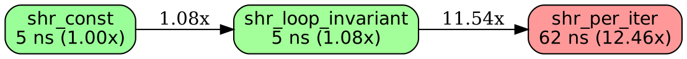

## shift_amount_origin/shift_amount_origin_n16384 on linux-x86_64-c16-bare-intel

Run `20261115T094618Z-266650fb-dirty`.

| variant | median | vs best |
|---|---|---|
| shr_const | 131 ns | 1.00x |
| shr_loop_invariant | 203 ns | 1.56x |
| shr_per_iter | 1.33 us | 10.22x |

## shift_amount_origin/shift_amount_origin_n16384 on macos-aarch64-c8-bare-apple

Run `20261114T232522Z-266650fb-dirty`.

| variant | median | vs best |
|---|---|---|
| shr_const | 195 ns | 1.00x |
| shr_loop_invariant | 205 ns | 1.05x |
| shr_per_iter | 710 ns | 3.64x |

## shift_amount_origin/shift_amount_origin_n256 on linux-x86_64-c16-bare-intel

Run `20261115T093839Z-266650fb-dirty`.

| variant | median | vs best |
|---|---|---|
| shr_const | 12 ns | 1.00x |
| shr_loop_invariant | 13 ns | 1.06x |
| shr_per_iter | 26 ns | 2.14x |

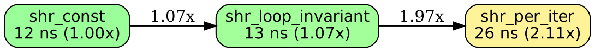

## shift_amount_origin/shift_amount_origin_n256 on macos-aarch64-c8-bare-apple

Run `20261114T232515Z-266650fb-dirty`.

| variant | median | vs best |
|---|---|---|
| shr_const | 1 ns | 1.00x |
| shr_loop_invariant | 2 ns | 3.12x |
| shr_per_iter | 7 ns | 8.87x |

## shift_amount_origin/shift_amount_origin_n4096 on linux-x86_64-c16-bare-intel

Run `20261115T094346Z-266650fb-dirty`.

| variant | median | vs best |
|---|---|---|
| shr_const | 50 ns | 1.00x |
| shr_loop_invariant | 61 ns | 1.23x |
| shr_per_iter | 342 ns | 6.89x |

## shift_amount_origin/shift_amount_origin_n4096 on macos-aarch64-c8-bare-apple

Run `20261114T232519Z-266650fb-dirty`.

| variant | median | vs best |
|---|---|---|
| shr_const | 70 ns | 1.00x |
| shr_loop_invariant | 70 ns | 1.01x |
| shr_per_iter | 193 ns | 2.78x |

## swap_band/swap_band_n1024 on linux-x86_64-c16-bare-intel

Run `20261115T095229Z-266650fb-dirty`.

| variant | median | vs best |
|---|---|---|
| sb_none | 9.90 us | 1.00x |
| sb_plan | 12.61 us | 1.27x |
| sb_value | 235.25 us | 23.77x |

## swap_band/swap_band_n1024 on macos-aarch64-c8-bare-apple

Run `20261114T232820Z-266650fb-dirty`.

| variant | median | vs best |
|---|---|---|
| sb_none | 10.04 us | 1.00x |
| sb_plan | 12.35 us | 1.23x |
| sb_value | 155.06 us | 15.45x |

## swap_band/swap_band_n64 on linux-x86_64-c16-bare-intel

Run `20261115T095023Z-266650fb-dirty`.

| variant | median | vs best |
|---|---|---|
| sb_none | 7.90 us | 1.00x |
| sb_plan | 10.11 us | 1.28x |
| sb_value | 16.20 us | 2.05x |

## swap_band/swap_band_n64 on macos-aarch64-c8-bare-apple

Run `20261114T232808Z-266650fb-dirty`.

| variant | median | vs best |
|---|---|---|
| sb_none | 10.02 us | 1.00x |
| sb_plan | 12.53 us | 1.25x |
| sb_value | 17.82 us | 1.78x |

## swap_band/swap_band_n8192 on linux-x86_64-c16-bare-intel

Run `20261115T095526Z-266650fb-dirty`.

| variant | median | vs best |
|---|---|---|
| sb_none | 11.02 us | 1.00x |
| sb_plan | 13.92 us | 1.26x |
| sb_value | 5.17 ms | 468.55x |

## swap_band/swap_band_n8192 on macos-aarch64-c8-bare-apple

Run `20261114T232949Z-266650fb-dirty`.

| variant | median | vs best |
|---|---|---|
| sb_none | 12.92 us | 1.00x |
| sb_plan | 15.24 us | 1.18x |
| sb_value | 2.54 ms | 196.70x |

## swap_column/swap_column_n1024 on linux-x86_64-c16-bare-intel

Run `20261115T100307Z-266650fb-dirty`.

| variant | median | vs best |
|---|---|---|
| cs_plain | 451.50 us | 1.00x |
| cs_exch | 707.51 us | 1.57x |
| cs_snap | 952.53 us | 2.11x |
| cs_snap_twin | 1.02 ms | 2.26x |

## swap_column/swap_column_n1024 on linux-x86_64-c4-container-intel

Run `20261113T190452Z-5e6887f-dirty`.

| variant | median | vs best |
|---|---|---|
| cs_plain | 584.76 us | 1.00x |
| cs_exch | 725.26 us | 1.24x |
| cs_snap_twin | 1.01 ms | 1.72x |
| cs_snap | 1.09 ms | 1.87x |

## swap_column/swap_column_n1024 on macos-aarch64-c8-bare-apple

Run `20261114T233320Z-266650fb-dirty`.

| variant | median | vs best |
|---|---|---|
| cs_plain | 209.26 us | 1.00x |
| cs_exch | 210.39 us | 1.01x |
| cs_snap | 301.32 us | 1.44x |
| cs_snap_twin | 307.54 us | 1.47x |

## swap_column/swap_column_n64 on linux-x86_64-c16-bare-intel

Run `20261115T100024Z-266650fb`.

| variant | median | vs best |
|---|---|---|
| cs_plain | 16.47 us | 1.00x |
| cs_snap | 21.77 us | 1.32x |
| cs_snap_twin | 22.61 us | 1.37x |

## swap_column/swap_column_n64 on linux-x86_64-c4-container-intel

Run `20261113T190201Z-5e6887f-dirty`.

| variant | median | vs best |
|---|---|---|
| cs_plain | 22.78 us | 1.00x |
| cs_exch | 25.26 us | 1.11x |
| cs_snap_twin | 30.05 us | 1.32x |
| cs_snap | 49.87 us | 2.19x |

## swap_column/swap_column_n64 on macos-aarch64-c8-bare-apple

Run `20261114T233303Z-266650fb-dirty`.

| variant | median | vs best |
|---|---|---|
| cs_exch | 21.75 us | 1.00x |
| cs_plain | 21.80 us | 1.00x |
| cs_snap | 27.07 us | 1.24x |
| cs_snap_twin | 27.46 us | 1.26x |

## swap_column/swap_column_n8192 on linux-x86_64-c16-bare-intel

Run `20261115T100719Z-266650fb-dirty`.

| variant | median | vs best |
|---|---|---|
| cs_plain | 6.29 ms | 1.00x |
| cs_exch | 7.15 ms | 1.14x |
| cs_snap | 9.09 ms | 1.45x |
| cs_snap_twin | 9.11 ms | 1.45x |

## swap_column/swap_column_n8192 on linux-x86_64-c4-container-intel

Run `20261113T190946Z-5e6887f-dirty`.

| variant | median | vs best |
|---|---|---|
| cs_plain | 10.16 ms | 1.00x |
| cs_exch | 11.54 ms | 1.14x |
| cs_snap_twin | 15.61 ms | 1.54x |
| cs_snap | 16.22 ms | 1.60x |

## swap_column/swap_column_n8192 on macos-aarch64-c8-bare-apple

Run `20261114T233524Z-266650fb-dirty`.

| variant | median | vs best |
|---|---|---|
| cs_exch | 2.25 ms | 1.00x |
| cs_plain | 3.18 ms | 1.41x |
| cs_snap_twin | 3.26 ms | 1.45x |
| cs_snap | 3.29 ms | 1.46x |

## swap_cost/swap_cost_n64 on linux-x86_64-c16-bare-intel

Run `20261115T101140Z-266650fb-dirty`.

| variant | median | vs best |
|---|---|---|
| sc_v64b | 10 ns | 1.00x |
| sc_v1k | 16 ns | 1.62x |
| sc_v64k | 2.16 us | 213.46x |

## swap_cost/swap_cost_n64 on macos-aarch64-c8-bare-apple

Run `20261114T233754Z-266650fb`.

| variant | median | vs best |
|---|---|---|
| sc_v64k | 1.71 us | 1.00x |

## wake_policy/wake_policy_n1024 on linux-x86_64-c16-bare-intel

Run `20261115T102359Z-266650fb-dirty`.

| variant | median | vs best |
|---|---|---|
| wp_spin | 21.94 us | 1.00x |
| wp_nh8k | 24.03 us | 1.10x |
| wp_park | 24.76 us | 1.13x |
| wp_nh128 | 25.51 us | 1.16x |
| wp_isb8 | 27.39 us | 1.25x |
| wp_lp0 | 30.51 us | 1.39x |
| wp_nh2k | 41.44 us | 1.89x |

## wake_policy/wake_policy_n1024 on macos-aarch64-c8-bare-apple

Run `20261114T234250Z-266650fb-dirty`.

| variant | median | vs best |
|---|---|---|
| wp_park | 8.74 us | 1.00x |
| wp_nh128 | 8.99 us | 1.03x |
| wp_lp0 | 9.03 us | 1.03x |
| wp_isb8 | 9.45 us | 1.08x |
| wp_nh2k | 12.17 us | 1.39x |
| wp_spin | 13.57 us | 1.55x |
| wp_nh8k | 17.71 us | 2.03x |

## wake_policy/wake_policy_n64 on linux-x86_64-c16-bare-intel

Run `20261115T101936Z-266650fb-dirty`.

| variant | median | vs best |
|---|---|---|
| wp_spin | 14.53 us | 1.00x |
| wp_park | 16.44 us | 1.13x |
| wp_nh8k | 17.19 us | 1.18x |
| wp_nh128 | 19.72 us | 1.36x |
| wp_lp0 | 23.89 us | 1.64x |
| wp_nh2k | 24.34 us | 1.67x |
| wp_isb8 | 30.45 us | 2.10x |

## wake_policy/wake_policy_n64 on macos-aarch64-c8-bare-apple

Run `20261114T234248Z-266650fb-dirty`.

| variant | median | vs best |
|---|---|---|
| wp_lp0 | 5.07 us | 1.00x |
| wp_park | 5.14 us | 1.01x |
| wp_isb8 | 5.55 us | 1.09x |
| wp_nh128 | 6.17 us | 1.22x |
| wp_nh2k | 9.66 us | 1.91x |
| wp_spin | 10.64 us | 2.10x |
| wp_nh8k | 10.89 us | 2.15x |

## wake_policy/wake_policy_n8192 on linux-x86_64-c16-bare-intel

Run `20261115T102820Z-266650fb-dirty`.

| variant | median | vs best |
|---|---|---|
| wp_spin | 56.73 us | 1.00x |
| wp_isb8 | 59.65 us | 1.05x |
| wp_park | 65.03 us | 1.15x |
| wp_nh128 | 67.90 us | 1.20x |
| wp_lp0 | 70.14 us | 1.24x |
| wp_nh8k | 70.17 us | 1.24x |
| wp_nh2k | 78.82 us | 1.39x |

## wake_policy/wake_policy_n8192 on macos-aarch64-c8-bare-apple

Run `20261114T234254Z-266650fb-dirty`.

| variant | median | vs best |
|---|---|---|
| wp_lp0 | 28.48 us | 1.00x |
| wp_isb8 | 30.41 us | 1.07x |
| wp_park | 33.34 us | 1.17x |
| wp_nh2k | 33.90 us | 1.19x |
| wp_nh128 | 34.09 us | 1.20x |
| wp_spin | 34.88 us | 1.22x |
| wp_nh8k | 41.65 us | 1.46x |

